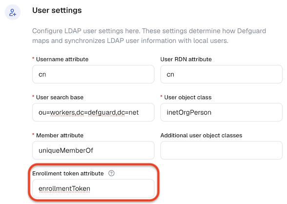
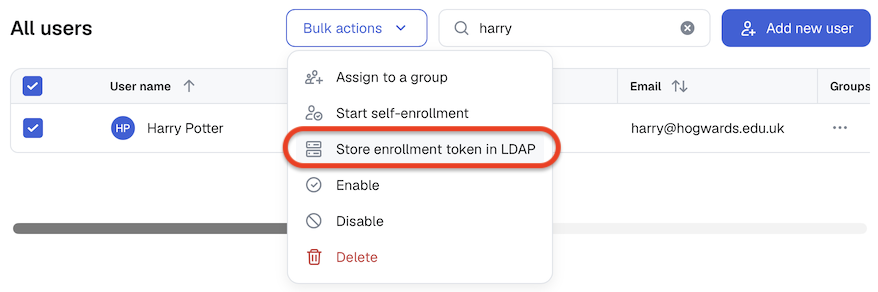

# On-premise Active Directory

## Overview

This guide describes an example desktop client provisioning scenario in an on-premise Active Directory environment.

The guide assumes that our goal is to provision desktop clients for a set of users in a specific AD group.

Please note that this is just a reference; you should adjust it to work with your specific environment and preferred tooling.

## Generating enrollment tokens

In Defguard Core:

- Open **Settings > External identity providers > LDAP and Active Directory**.
- Under **User settings**, enter the name of the LDAP attribute that will hold the enrollment token.

<figure><figcaption></figcaption></figure>

With the LDAP attribute name configured:
- Go to **Users**.
- Select the desired users.
- Click **Bulk actions > Store enrollment token in LDAP**.
- Confirm the action in the dialog that appears.

<figure><figcaption></figcaption></figure>

The enrollment tokens should now be stored in LDAP under the specified attribute.

### Using PowerShell

To automate the process as much as possible, we've prepared an example PowerShell script that can be used to generate enrollment tokens for all users in a specified group. The script can be downloaded [here](https://github.com/DefGuard/client/blob/555fb727d3599264996ee1ac99f5124026083146/src-tauri/resources-windows/admin-scripts/GenerateEnrollmentTokensAD.ps1).

### Prerequisites

* Network access to both the Defguard instance and the AD domain controller
* The `ActiveDirectory` PowerShell module; to install it, run the following command in an admin shell: `Get-WindowsCapability -Name RSAT.ActiveDirectory.DS-LDS.Tools~~~~0.0.1.0 -Online | Add-WindowsCapability -Online`

### Defguard authentication

To securely access your Defguard instance's REST API, you need to generate an [API token](../../integrations/api-tokens.md#generating-api-token).

### Active Directory authentication

By default, the script uses the current user's credentials for AD authentication.

Alternatively, if you specify a username with the `ADUsername` parameter, you'll be prompted for a password.

### Required parameters

* `Url` - URL of your Defguard instance
* `ApiToken` - your API token for Defguard API access
* `GroupName` - name of the user group for which to generate enrollment tokens
* `ADAttribute` - name of the AD attribute where the provisioning config data will be stored

### Optional parameters

* `ADUsername` - username for domain controller authentication
* `DomainController` - your AD domain controller URL
* `EnrollmentTokenExpirationTime` - how long the generated enrollment tokens should be valid for (default is 24h); should be specified as a human-readable string, e.g. 24h, 1d, 2w, etc.

### Example script execution command

`.\GenerateEnrollmentTokens.ps1 -Url "https://defguard.example.com" -ApiToken "dg-your-generated-token" -GroupName "DgProvisioning" -ADAttribute "extensionAttribute3" -ADUsername "administrator" -DomainController "ad.example.com"`

## Client provisioning scenario

1. **Set up target users**
   * Prepare a user group containing all the users you intend to perform client provisioning for
2. **User synchronization**
   * Configure two-way Active Directory synchronization as described [here](../../ldap-and-active-directory-integration/two-way-ldap-and-active-directory-synchronization.md)
3. **Token Generation**
   * Generate enrollment tokens for users using the [helper script](on-premise-active-directory-environments.md#generating-enrollment-tokens)
4. **Client Installation**
   * Install the `defguard-client` application on user machines using the [MSI installer](./#msi-installer-integration)
   * Pass the `PROVISIONING=1` argument to execute the provisioning script during installation
   * Example command: `msiexec /i defguard-client.msi PROVISIONING=1 ADAttribute="description"`
5. **Automatic Configuration**
   * During installation, the bundled script fetches [provisioning configuration](./#active-directory-configuration) from Active Directory
   * The configuration is written to the client's [data directory](../../../using-defguard-for-end-users/desktop-client/#storage) as explained [here](./#configuration-file-creation)
6. **User Enrollment**
   * When the user launches the client for the first time, they are guided through the enrollment process
   * The enrollment uses the pre-configured token and URL from the provisioning file
7. **Client Ready**
   * Once enrollment is complete, the user can establish VPN connections and access protected resources
