# Preshared keys for network devices


**Availability**

This feature is available in all plans, starting with Defguard 2.2.1. A device that uses the [Defguard CLI](./#defguard-cli-installation-and-usage) needs Defguard CLI 2.2.2 or later to receive the key.


A [network device](./) can use a WireGuard preshared key. Use this page to add a network device with a preshared key, to keep the key of a peer that you move to Defguard, and to replace or remove the key later.

## Overview

Every WireGuard connection uses a key pair on each side: a private key that stays on the device and a public key that the other side knows. A **preshared key** is an optional third key. It is one secret that both sides of the tunnel have. WireGuard mixes it into the handshake, so a connection starts only when both sides have the same preshared key.

You see it in a WireGuard configuration file as a `PresharedKey =` line in the `[Peer]` section:

```ini
[Peer]
PublicKey = 9PLW4YHTPVO701SQvIWMsizdTKmtqHPY6lpTAubQZgg=
PresharedKey = 53Oi/CRvc9boCcFe547/7X2i4vq5awkjl6ZkNL5RyME=
AllowedIPs = 10.20.0.0/24
Endpoint = vpn.example.com:51820
```

Use a preshared key on a network device when:

* **You move existing WireGuard peers to Defguard.** A router or server that already has a `PresharedKey` line keeps connecting after you add it to Defguard with the same key. You do not have to change its configuration, other than the server it connects to.
* **Your security policy asks for a preshared key** on each WireGuard tunnel, as an extra layer on top of the key pairs.

You can let Defguard make the key, or give your own:

|                                   | Generate a preshared key                          | Provide your own preshared key                     |
| --------------------------------- | ------------------------------------------------- | -------------------------------------------------- |
| Who makes the key                 | Your browser, with a secure random generator      | You, for example with `wg genpsk`                  |
| When to use it                    | A new device                                      | A device that already has a preshared key          |
| Where the device gets the key     | From the configuration file or the Defguard CLI   | It already has it                                  |


Defguard uses the preshared key only in locations that have **MFA** and **posture checks** turned off. In other locations, the connection gets its key from the VPN session, and Defguard does not send the static key to the gateway. The form to add a network device lists only locations without MFA. See [Multi-Factor Authentication](../wireguard/multi-factor-authentication-mfa-2fa/README.md) and [Device posture verification](../device-posture-verification.md).


## Before you start

You need:

* An admin account in Defguard.
* A location without MFA and without posture checks, with a gateway that is connected.
* For a device that you move from another WireGuard server: its public key and its current preshared key. You find the preshared key in the device's WireGuard configuration file, in the `PresharedKey =` line. On the old server, `wg show <interface> preshared-keys` prints the key of each peer.
* For a device that uses the Defguard CLI: Defguard CLI 2.2.2 or later on that device.

## Step 1: Open the form to add a network device

1. In the left menu, click **Network Devices**.
2. Click **Add new network device**.

<figure>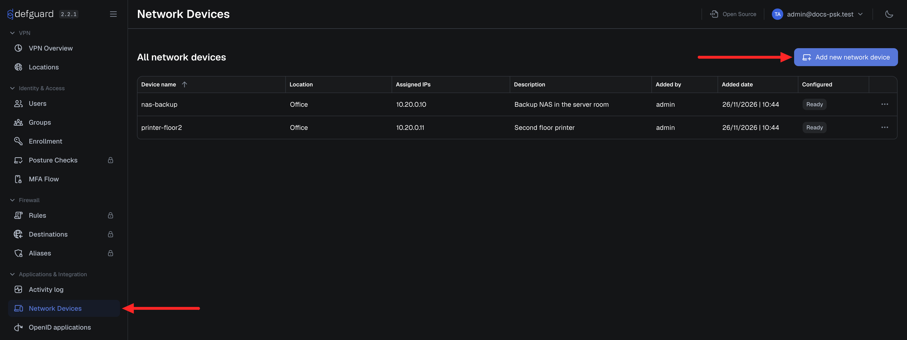<figcaption></figcaption></figure>

3. Select how the device connects:
   * **Manual WireGuard Client**: the device uses a WireGuard configuration file. Select this for a router, a server or any device that you move from another WireGuard server.
   * **Defguard CLI**: the device runs the Defguard CLI, which gets its configuration from Defguard. Go to [With the Defguard CLI](#with-the-defguard-cli).

<figure>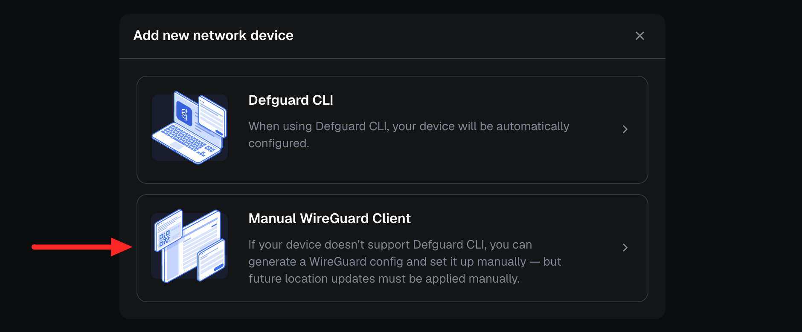<figcaption></figcaption></figure>

## Step 2: Fill in the device details

1. In **Location**, select the location the device connects to.
2. In **Device name**, type a name, for example `branch-router`.
3. Optional: in **Description**, type a description.
4. Keep the suggested **Assigned IP Address**, or type the IP address the device used before. A device that you move from another server usually needs its old address.
5. Under **Choose setup method**, select one option:
   * **Provide your own public key** for a device that already has a key pair. Paste its public key into **Public key**.
   * **Generate key pair** for a new device. Defguard puts the new private key in the configuration file.

For more about these fields, see [Network devices](./#using-the-manual-wireguard-client).

## Step 3: Turn on the preshared key

1. Click the **Preshared key** switch.

<figure>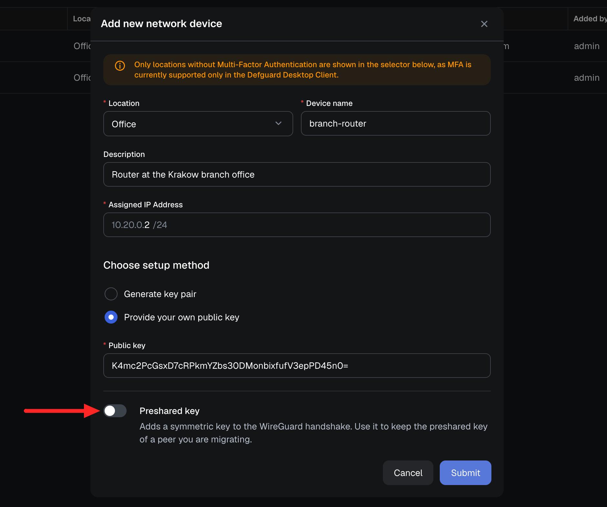<figcaption></figcaption></figure>

2. Select where the key comes from:
   * **Generate a preshared key**: Defguard makes a new key. Use this for a new device.
   * **Provide your own preshared key**: then paste the device's current key into the **Preshared key** field. Use this for a device that you move from another server.
3. Click **Submit**.

<figure>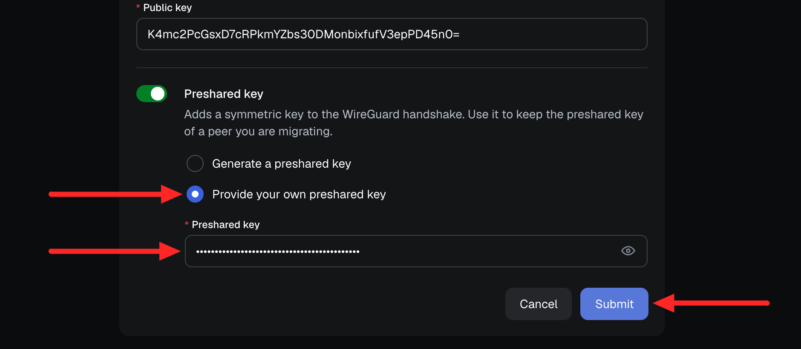<figcaption></figcaption></figure>

A preshared key is 32 bytes, written in Base64: 44 characters that end with `=`. If the key has a different format, the form shows **Preshared key must be a base64-encoded 32-byte key**.

## Step 4: Set up the device

1. Defguard shows the WireGuard configuration of the device. The `[Peer]` section has a `PresharedKey =` line with the key.
2. Click **Download config file** or **Copy to clipboard**.

<figure>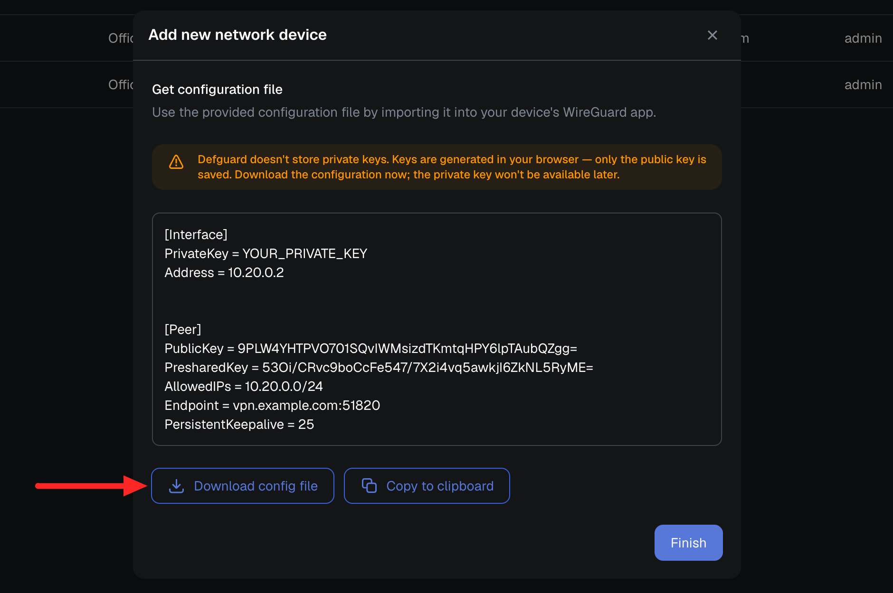<figcaption></figcaption></figure>

3. Import the configuration on the device:
   * For a new device, import the whole file into its WireGuard app.
   * For a device that you move, it already has the same key pair and preshared key. Change only the values that are different on the new server, usually `PublicKey` and `Endpoint` in the `[Peer]` section.
4. Click **Finish**.


This is the only time Defguard shows the whole configuration with the preshared key. Keep the file safe. It contains the key in plain text, and Defguard does not show the key again.


### With the Defguard CLI

If you selected **Defguard CLI** in Step 1:

1. Fill in the device details.
2. Click the **Preshared key** switch.
3. Keep **Generate a preshared key** selected, or select **Provide your own preshared key** and paste the key.
4. Click **Submit**.

<figure>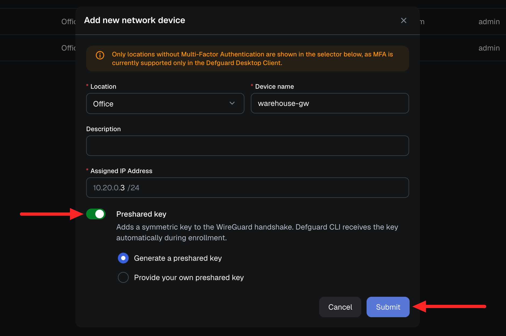<figcaption></figcaption></figure>

5. Run the `dg enroll` command that Defguard shows on the device. See [Enrollment](./#enrollment).

The Defguard CLI receives the preshared key during enrollment. You do not copy the key yourself.

## Check whether a device uses a preshared key

1. In **Network Devices**, click the **⋯** menu at the end of the device's row.
2. Click **View config**.

<figure>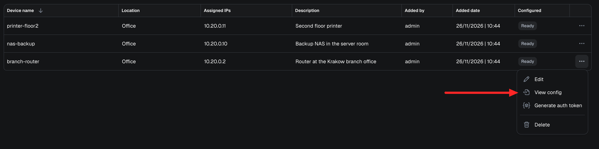<figcaption></figcaption></figure>

When the device uses a preshared key, the window shows **This device uses a preshared key**, and the configuration has the line `PresharedKey = YOUR_PRESHARED_KEY`. Defguard does not show the key itself. Replace `YOUR_PRESHARED_KEY` with the key that you set on the device.

<figure>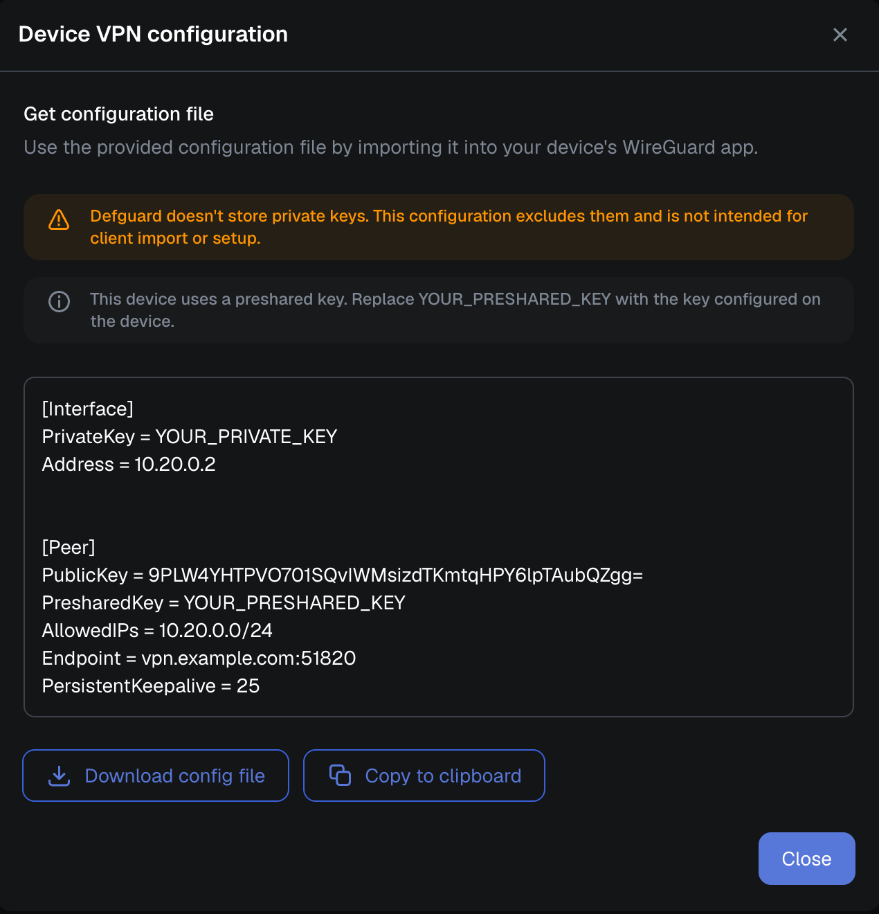<figcaption></figcaption></figure>

In the **Edit** window, the **Preshared key** switch is on for a device with a key.

## Replace the preshared key

Replace the key when it was exposed, or when your policy asks you to change keys on a schedule.

1. In **Network Devices**, click the **⋯** menu of the device, then click **Edit**.

<figure>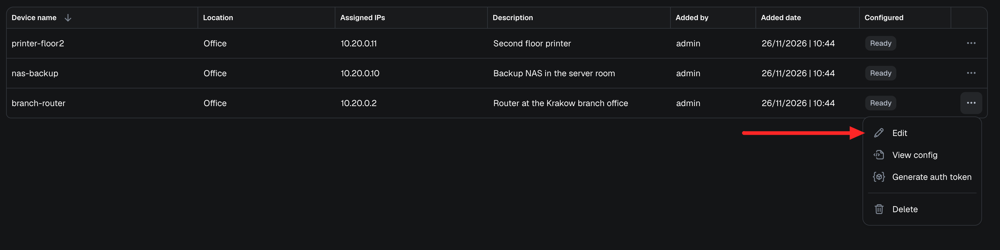<figcaption></figcaption></figure>

2. Do one of these:
   * Select **Generate new preshared key** to let Defguard make a new key.
   * Paste a new key into the **Preshared key** field.
3. Click **Save changes**.

<figure>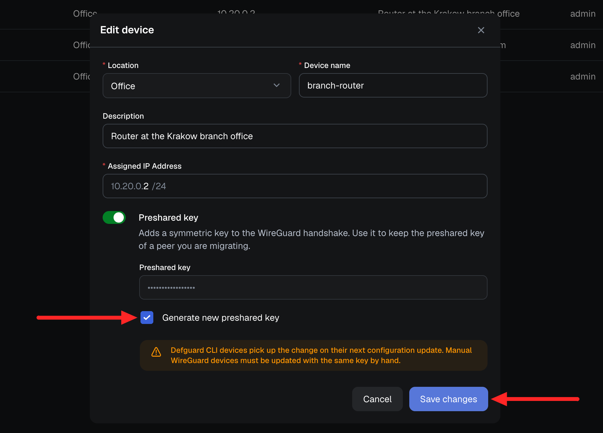<figcaption></figcaption></figure>

4. If Defguard generated the key, it shows the new key once. Click the copy icon, then click **Finish**.

<figure>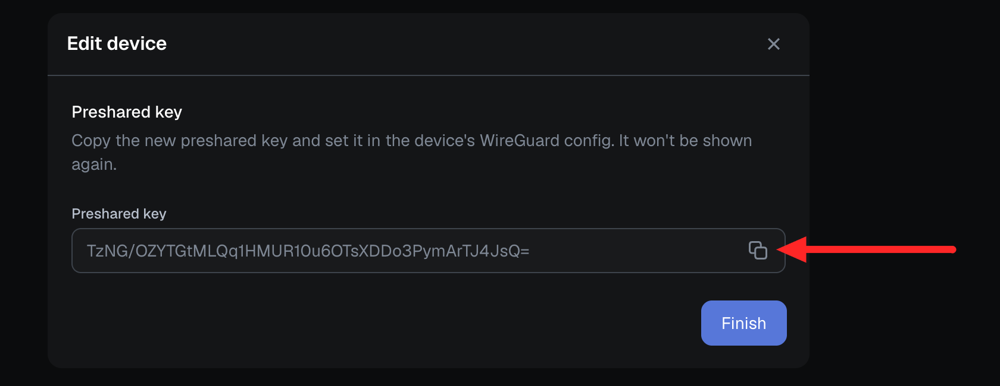<figcaption></figcaption></figure>

5. Put the new key on the device:
   * **Manual WireGuard device**: change the `PresharedKey =` line in its configuration to the new key, then restart the tunnel.
   * **Defguard CLI device**: with a Business or Enterprise plan, the CLI gets the new key with its next [automatic configuration update](./#automatic-config-fetching-polling). Without one, click **Generate auth token** in the **⋯** menu and run the new `dg enroll` command on the device.

The gateway uses the new key as soon as you save. Until the device has the same key, it cannot connect.

## Remove the preshared key

1. In **Network Devices**, click the **⋯** menu of the device, then click **Edit**.
2. Click the **Preshared key** switch to turn it off. Defguard shows **The preshared key will be removed when you save. The device must stop using it to keep connecting.**
3. Click **Save changes**.

<figure>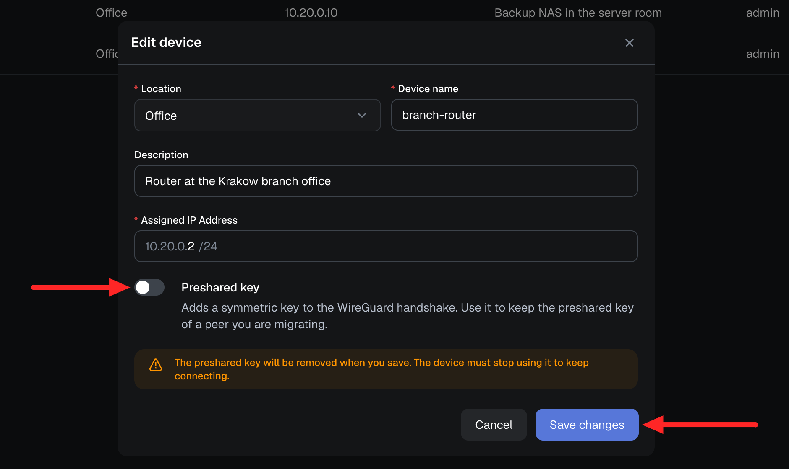<figcaption></figcaption></figure>

4. On a manual WireGuard device, delete the `PresharedKey =` line from its configuration, then restart the tunnel.

## Activity log

When you add, replace or remove a preshared key, the [activity log](../activity-log/README.md) records a **Network device modified** event. The event says whether the key was set before and after the change. It never contains the key itself.

## REST API

The [REST API](../integrations/api-tokens.md) accepts an optional `preshared_key` field, a Base64 string of 32 bytes:

| Request                                   | `preshared_key`                                                            |
| ----------------------------------------- | -------------------------------------------------------------------------- |
| `POST /api/v1/device/network`             | Sets the key of a new manual WireGuard device                              |
| `POST /api/v1/device/network/start_cli`   | Sets the key of a new Defguard CLI device                                  |
| `PUT /api/v1/device/network/{id}`         | A key replaces the current key. `null` removes it. Leave the field out to keep the current key |

Responses never contain the key. They have a `preshared_key_set` field that is `true` when the device has a key. A key in the wrong format returns `400` with `{"msg":"Preshared key must be a base64-encoded 32-byte key"}`.

## Troubleshooting

| What you see | Cause | Fix |
| ------------ | ----- | --- |
| **Preshared key must be a base64-encoded 32-byte key** under the field | The key is not 32 bytes in Base64. It may have a space, a missing `=`, or a different length. | Copy the key again, without the `PresharedKey =` part. It has 44 characters and ends with `=`. To make a new key, run `wg genpsk`. |
| The device does not connect after you add the key | The key on the device and the key in Defguard are different. WireGuard shows no error. The handshake does not complete. | Replace the key in Defguard with the key from the device, or put the Defguard key on the device. |
| The device stopped connecting after you replaced or removed the key | The device still uses the old key. | Put the new key on the device, or delete its `PresharedKey =` line if you removed the key. |
| A Defguard CLI device does not connect after you add a key | The Defguard CLI on the device is older than 2.2.2 and does not use the key. | Update the Defguard CLI to 2.2.2 or later, then run `dg enroll` again with a new token (**⋯** > **Generate auth token**). |
| A device with a preshared key does not connect, and its location has posture checks | Defguard does not send the static key to the gateway in a location with MFA or posture checks. | Use a location without MFA and without posture checks for this device. |

<figure>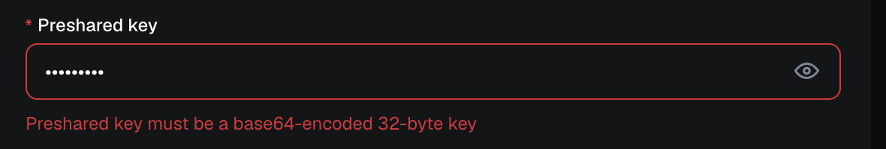<figcaption></figcaption></figure>
