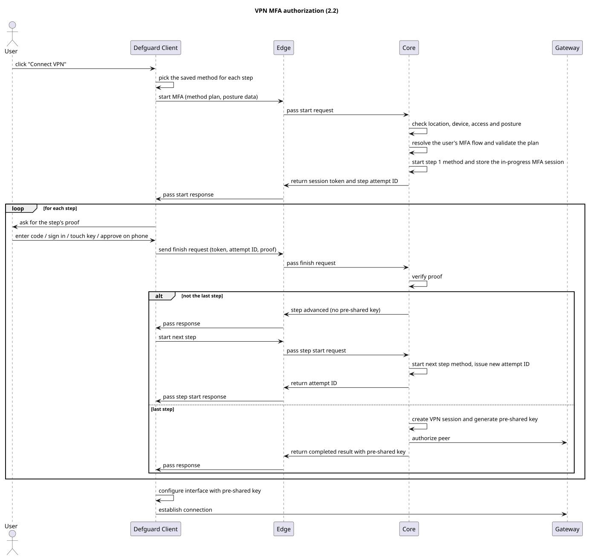

# MFA Architecture

WireGuard by itself does not have a concept of MFA or any additional authorization aside from validating peers cryptographically by their public and pre-shared keys.

MFA in the Defguard desktop and mobile clients is built entirely in Defguard as a layer above the WireGuard protocol. Below is a brief explanation of its architecture and the authorization process itself.

## Pre-shared keys

Our additional authorization is enabled by using [pre-shared keys](https://www.wireguard.com/protocol/#key-exchange-and-data-packets). They are similar to peer public keys, but while public keys identify a specific device and are static, pre-shared keys can be safely rotated.

When you configure your Defguard location to require MFA, it tells the Gateway to not add any peers (clients) to the WireGuard interface unless they are authorized and have a pre-shared key assigned. Locations with [device posture checks](../../features/device-posture-verification.md) gate peers the same way, even without MFA: a peer is added only after its connection passes the checks.

On the other side, a Client must have a valid pre-shared key (received after successful authorization) to establish a connection to the Gateway.

In typical REST API terms, the pre-shared key can be thought of as an analogue to a session token.

## Authorization process

To enable MFA functionality, the Defguard desktop and mobile clients use the [Edge](https://github.com/DefGuard/proxy) to bridge communication between themselves and Defguard Core. Below is a diagram of the authorization process that is performed each time a Client initiates a connection to an MFA-enabled location:

<figure><figcaption></figcaption></figure>

A location's [MFA flow](../../features/wireguard/multi-factor-authentication-mfa-2fa/mfa-flows-and-methods.md) has one or more steps, and the Client repeats the verification exchange once per step. Core keeps the progress of the flow in an in-progress MFA session stored in its database, identified by an opaque token that Core stores only as a hash. Each step has its own attempt ID, so a proof is accepted only for the step it was issued for. Passing a step that is not the last one only advances that session: no pre-shared key is created and the Gateway is not told anything.

Only after the last step does Core create the VPN session, issue the pre-shared key and authorize the peer on the Gateway. The whole flow has to be completed within 10 minutes of starting it, and five failed verifications in one step end the in-progress session, so the Client has to start again.

## Disconnecting peers

Since the WireGuard protocol is by definition stateless, there's no native concept of "connection" which would allow us to detect disconnected peers and remove them from the Gateway.

As a workaround, we use the `latest handshake` parameter that the Gateway reports for each peer in its [statistics](how-do-vpn-statistics-work.md). For each WireGuard connection, both sides negotiate a "[mini-session](https://www.wireguard.com/protocol/#dos-mitigation)" about every 2 minutes, so a peer whose latest handshake is old has stopped talking to the Gateway.

Every minute, Core compares each connected session's latest handshake with the location's [Client disconnect threshold](../../features/wireguard/create-your-vpn-network/#client-disconnect-threshold) (at least 120 seconds). A session whose latest handshake is older than the threshold is closed. A session that was authorized but never connected within the threshold is closed as well.

Closing a session on an MFA location removes the peer from the Gateway interface, so its pre-shared key no longer works. This enforces a "logout" for our MFA session: to connect again, the user has to complete the MFA flow again and receives a new pre-shared key.
