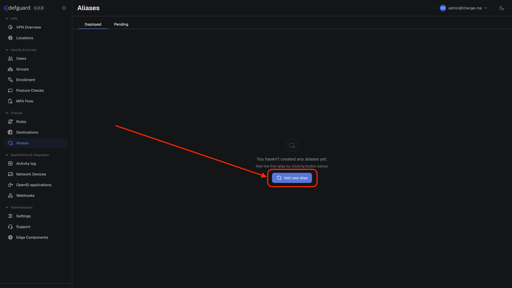
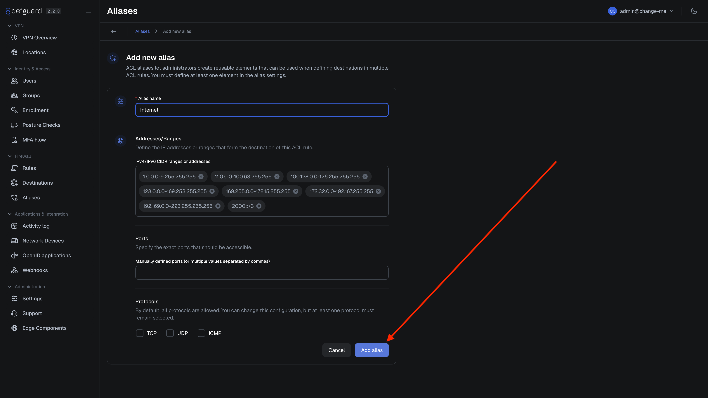
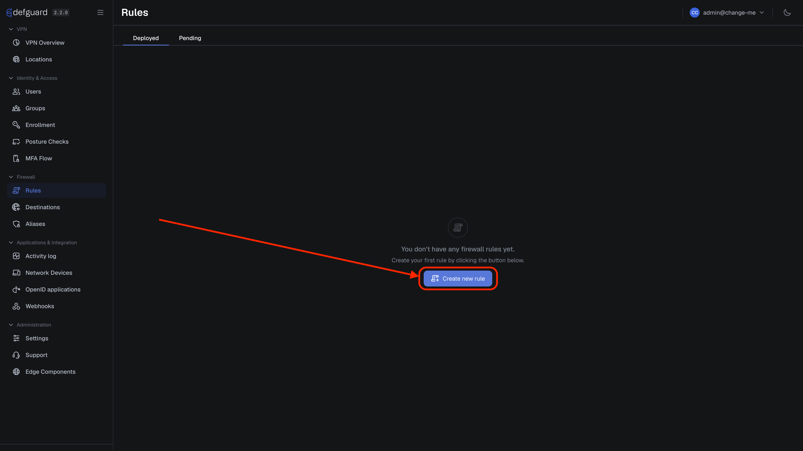
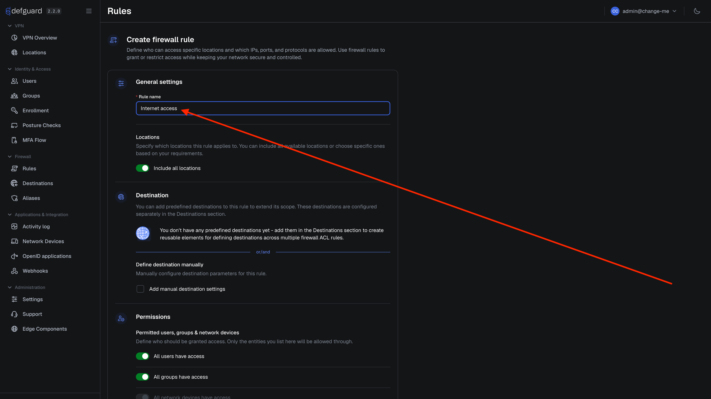
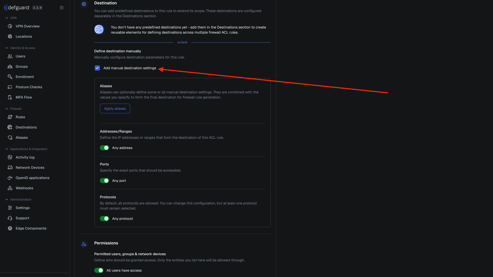
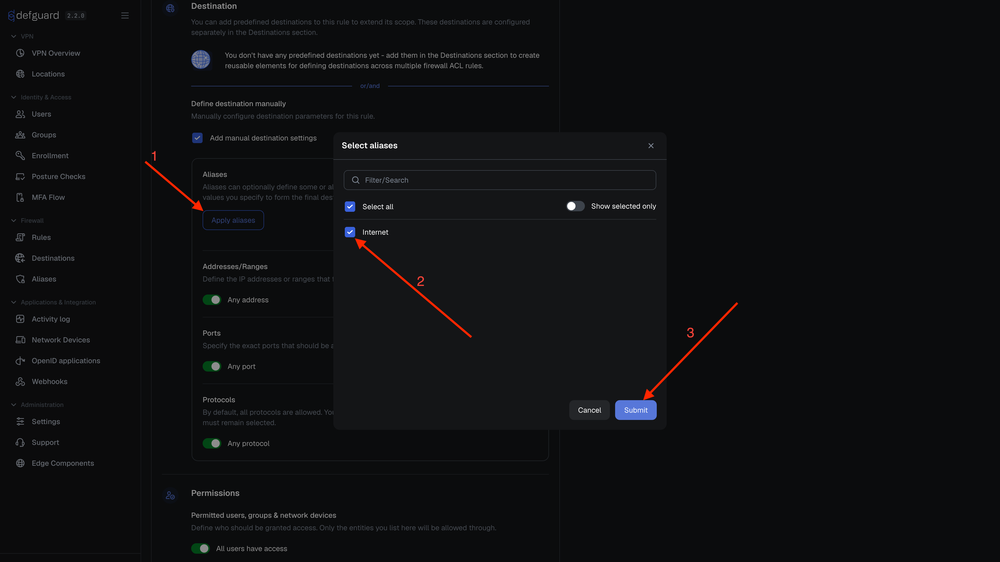
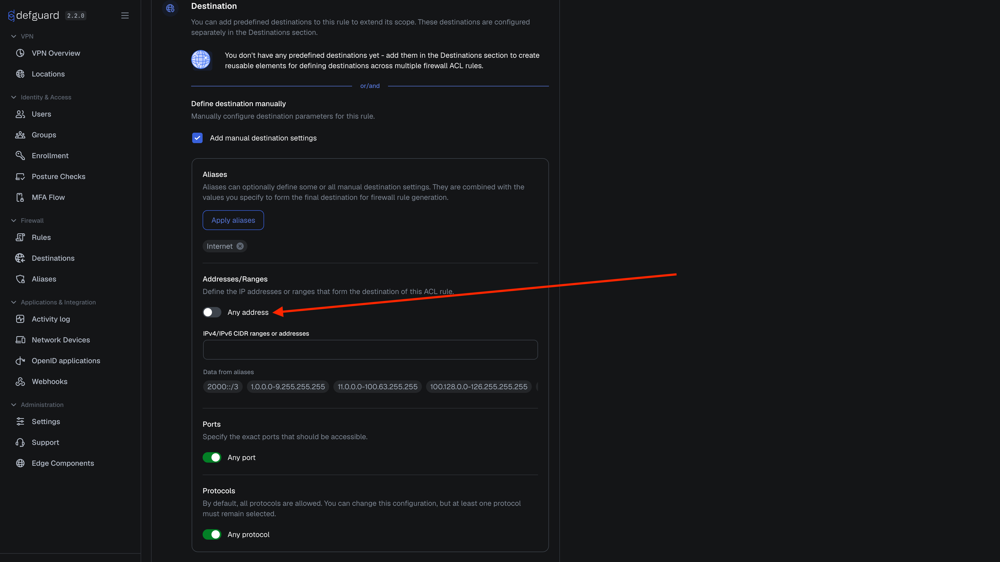
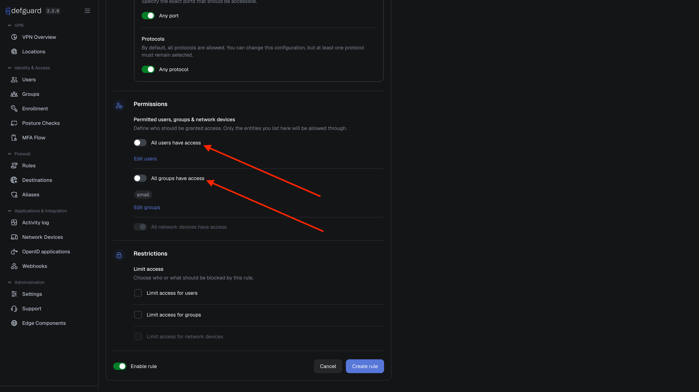
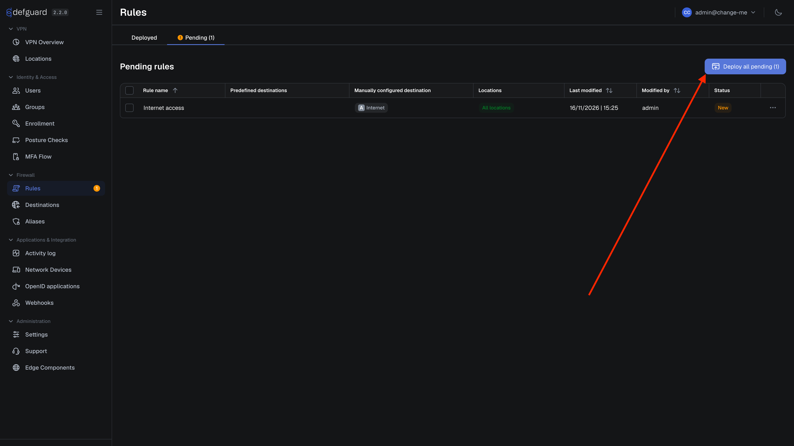

# Allowing internet access without access to private networks

To give selected users internet access through the VPN without access to your internal networks, create an alias that contains public internet addresses only and use it as the destination of a firewall rule.

Use this guide when all of these apply:

- The location routes all client traffic through the VPN.
- The location's Firewall is set to **Default Deny**.
- Selected users or groups should reach the internet, but not your internal networks.


This guide covers the firewall rule only. Internet access through the VPN also needs NAT or masquerading on the gateway. See [Can access VPN but not local network or internet](can-access-vpn-but-not-local-network-or-internet.md).


### Why Any address does not work

A rule with **Any address** as its destination also allows your internal networks. A second rule that blocks them does not help, because Defguard applies the **ALLOW** part of every rule before any **DENY** part. See [How rules work](../../features/firewall/#how-rules-work).

Instead, the rule's destination is an [Alias](../../features/firewall/aliases-and-destinations.md) that contains public addresses only.

### What the alias blocks

The alias contains all IPv4 addresses except the ranges below, and only the global unicast IPv6 range `2000::/3`. Traffic to everything else stays blocked by **Default Deny**.

| Not in the alias        | Reserved for                                                   |
| ----------------------- | -------------------------------------------------------------- |
| `0.0.0.0/8`             | "This network"                                                 |
| `10.0.0.0/8`            | Private networks (RFC 1918)                                    |
| `100.64.0.0/10`         | Carrier-grade NAT                                              |
| `127.0.0.0/8`           | Loopback                                                       |
| `169.254.0.0/16`        | Link-local                                                     |
| `172.16.0.0/12`         | Private networks (RFC 1918)                                    |
| `192.168.0.0/16`        | Private networks (RFC 1918)                                    |
| `224.0.0.0/3`           | Multicast and reserved                                         |
| IPv6 outside `2000::/3` | Unique local (`fc00::/7`), link-local (`fe80::/10`), multicast |


Compare this table with your own networks before you continue. An internal network that is not in the table, for example a public address block used internally, stays reachable. Remove it from the alias as described in [Excluding your own networks](allowing-internet-access-without-access-to-private-networks.md#excluding-your-own-networks).


### Create the Internet alias

1.  In the **Firewall** section of the navigation, open **Aliases** and click **Add new alias**.

    <figure></figure>

2.  Enter an **Alias name**, for example `Internet`.
3.  Add the following ranges to **IPv4/IPv6 CIDR ranges or addresses**.

    ```
    1.0.0.0-9.255.255.255
    11.0.0.0-100.63.255.255
    100.128.0.0-126.255.255.255
    128.0.0.0-169.253.255.255
    169.255.0.0-172.15.255.255
    172.32.0.0-192.167.255.255
    192.169.0.0-223.255.255.255
    2000::/3
    ```

4.  Leave the ports and protocols empty and click **Add alias**.

    <figure></figure>

#### Excluding your own networks

Networks in private ranges, such as `10.0.0.0/24`, are already outside the alias. You only need this if one of your internal networks uses public addresses.

For example, your company's servers in a data centre use the public network `203.0.113.0/24`, which covers the addresses from `203.0.113.0` to `203.0.113.255`. This network is inside the alias range `192.169.0.0-223.255.255.255`, so the rule would let users reach these servers.

To block them, remove `192.169.0.0-223.255.255.255` from the alias and add two ranges in its place. The first ends right before your network, the second starts right after it:

```
192.169.0.0-203.0.112.255
203.0.114.0-223.255.255.255
```

IPv6 ranges work the same way.

### Create the rule

1.  Open **Rules** and click **Create new rule**.

    <figure></figure>

2.  Enter a **Rule name**. To apply the rule to selected locations only, turn off **Include all locations** and select them.

    <figure></figure>

3.  In the **Destination** section, check **Add manual destination settings**.

    <figure></figure>

4.  Click **Apply aliases** and select the `Internet` alias.

    <figure></figure>

5.  Turn off **Any address** and leave the address field empty. Keep **Any port** and **Any protocol** turned on.

    <figure></figure>

6.  In the **Permissions** section, turn off **All users have access**, **All groups have access** and, if you have network devices, **All network devices have access**. Then select the users or groups that should have internet access. In this example, only members of the `small` group have internet access.

    <figure></figure>

7.  Click **Create rule**.

### Deploy the rule

The new rule has no effect until it is deployed. Open the **Pending** tab on the **Rules** page and click **Deploy all pending**.

<figure></figure>

After the deployment:

- The users and groups selected in the rule can use the internet through the VPN.
- Internal networks stay blocked by the **Default Deny** policy. To give someone access to an internal resource, create a separate rule for that resource.
- Other users connected to the location have no internet access through the VPN.

### Internal DNS servers

If the location's DNS servers are in one of the blocked ranges, create a separate rule that allows access to them.

### Keeping the alias up to date

The reserved ranges in the table come from internet standards and rarely change. Your own networks can change, and Defguard does not update the alias automatically. When you add an internal network that uses public addresses, exclude it from the alias as described in [Excluding your own networks](allowing-internet-access-without-access-to-private-networks.md#excluding-your-own-networks). Changes to a deployed alias take effect only after you deploy them. See [Modifying](../../features/firewall/aliases-and-destinations.md#modifying).
