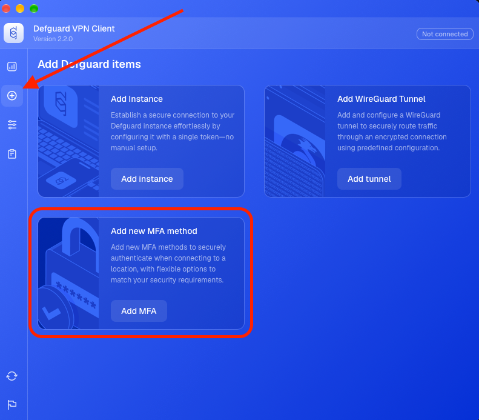
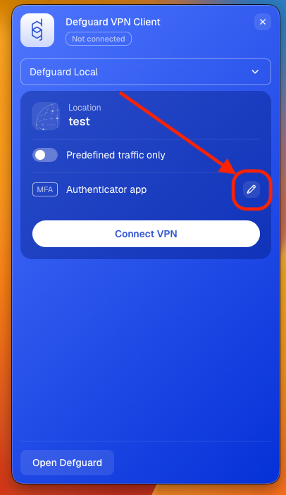
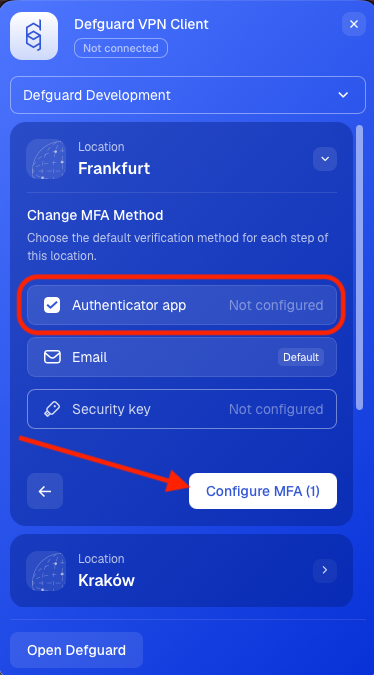
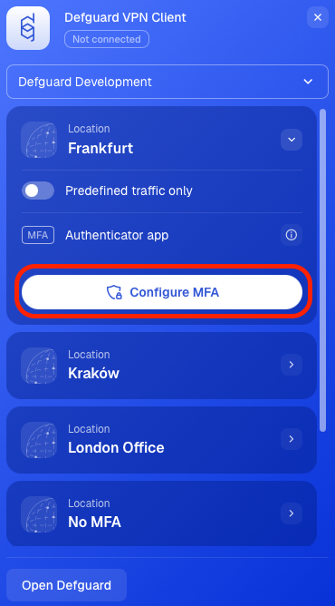
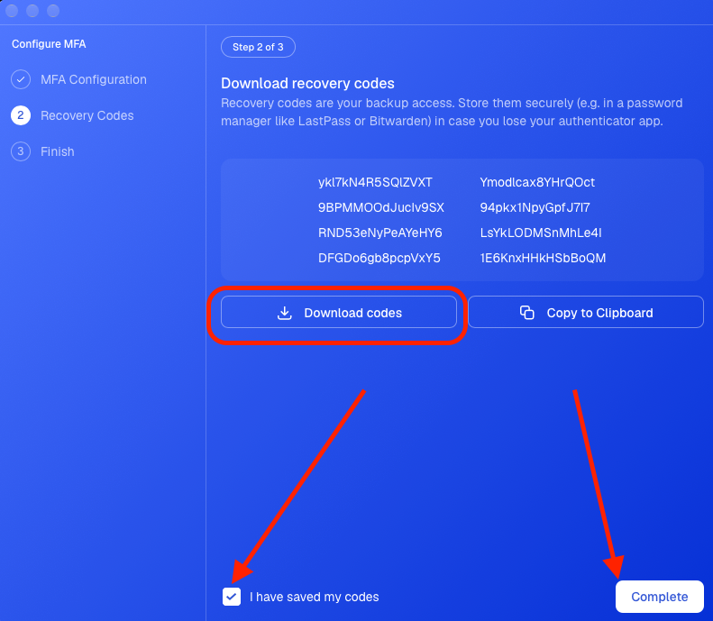
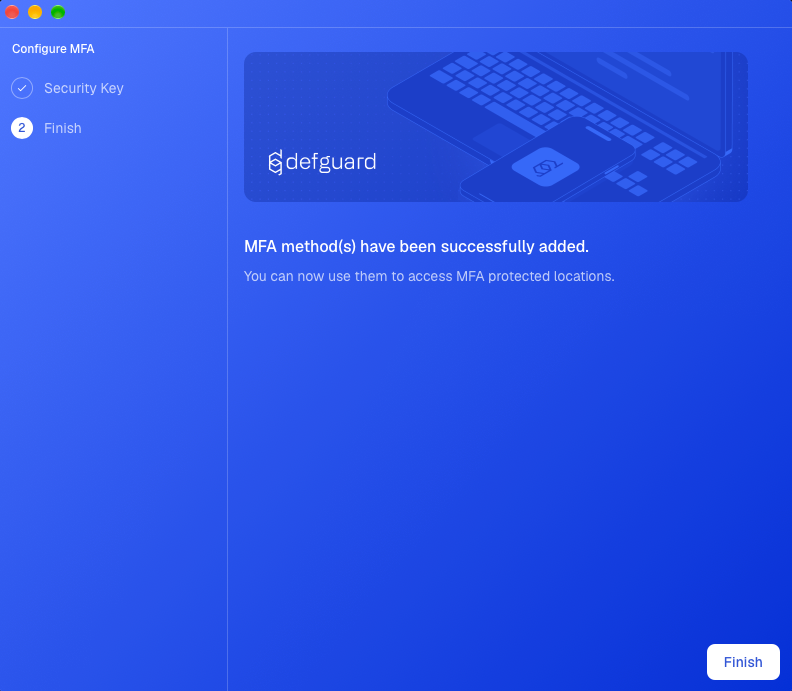

# Configuring MFA methods in the Desktop Client

In this guide, you will learn how to add new MFA methods in the Defguard Desktop client.&#x20;

This process allows you to add the following MFA methods:

* Email
* Authenticator app
* FIDO2 Security Key

If you prefer a video guide watch the following.





## Pick an entry point for the configure MFA process

There a three ways you can start the configure MFA methods process in the Defguard Desktop Client. Pick one according to your situation.

### Adding an MFA method from the Add page

Useful when you just want to add a new MFA method. Open Defguard in full window mode, click the + icon in the main menu and then click the Add new MFA method tile.

<figure><figcaption></figcaption></figure>

### Adding an MFA method from a location's MFA preferences

Useful when you want to quickly add a new, more preferable method and set it as you default one.

<figure><figcaption></figcaption></figure> <figure><figcaption></figcaption></figure>

### Adding a required MFA method you haven't configured yet

If a location requires an MFA method you haven't set up yet, you will see **Configure MFA** instead of **Connect VPN** on that location. You won't be locked out. Just configure the missing method and you can Connect back again.

<figure><figcaption></figcaption></figure>



## Verify your identity

Before adding a new method, Defguard asks you to confirm your identity with a method you have already set up. If you don't have any MFA method yet, Defguard sends a verification code to your email instead.

<figure><figcaption></figcaption></figure>



## Select MFA methods to configure

Then select the MFA methods you want to add to your profile.

Methods already configured that can only be added once (like the Authenticator app or Email) are marked as _Not configurable_.

You can have multiple FIDO2 Security Keys in your profile so this method can be configured multiple times.

<figure><figcaption></figcaption></figure>



## Configure the selected methods

After you selected the methods to configure, Defguard Client will guide you through configuring each of them in a convinient wizard.

<figure><figcaption></figcaption></figure>



## Store your recovery codes recurly

If that's the first time you configure an MFA method Defguard will present recoevery codes. These can be used when signing in to [your profile](../setting-up-2fa-mfa.md#accessing-the-profile-page) in case you lost access to all the configured MFA methods. Store them securly.

<figure><figcaption></figcaption></figure>



## Finishing the configuration

Your new MFA methods can be used immediately. To connect to a location with MFA, check out [this guide](using-multi-factor-authentication-mfa.md).

<figure><figcaption></figcaption></figure>


