# Configuring MFA methods

In this guide, you will learn how to add new MFA methods in the Defguard desktop client.

## Starting from a location

If a location requires an MFA method you haven't set up yet, you will see **Configure MFA** instead of **Connect VPN** on that location.

### Desktop client in tray view mode

1. Click **Configure MFA** on the location.

<figure>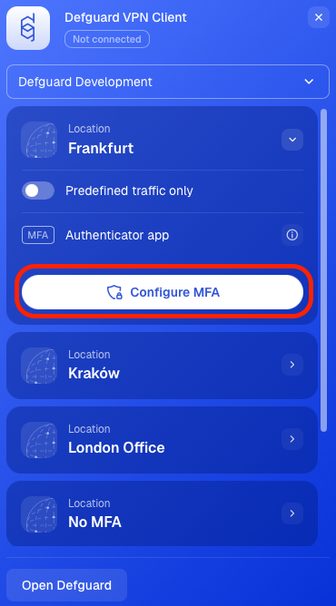</figure>

2. Continue with [Selecting MFA methods](configuring-mfa-methods.md#selecting-mfa-methods).

### Desktop client in full view mode

1. Click **Configure MFA** on the location.

<figure>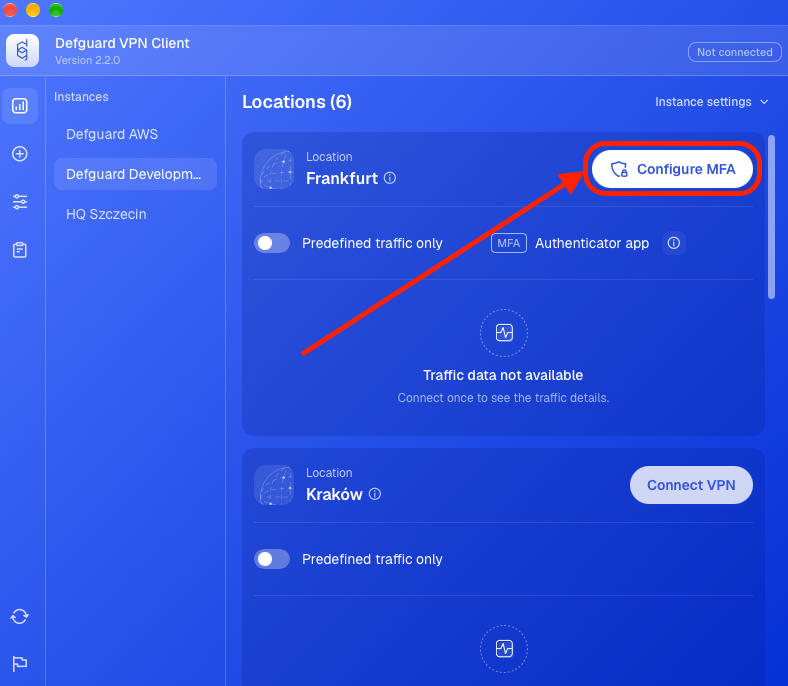</figure>

2. Continue with [Selecting MFA methods](configuring-mfa-methods.md#selecting-mfa-methods).

## Starting from the Add page

1. If you don't have **Defguard** in full view mode, open **Defguard** from tray view, and click **Open Defguard**.

<figure>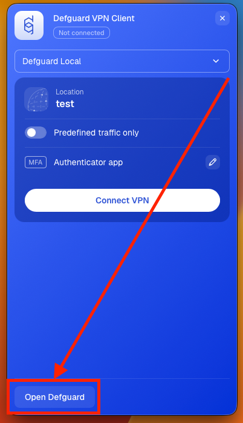</figure>

2. Click the **+** icon in the navigation bar.
3. Click **Add MFA** on the **Add new MFA method** card.

<figure>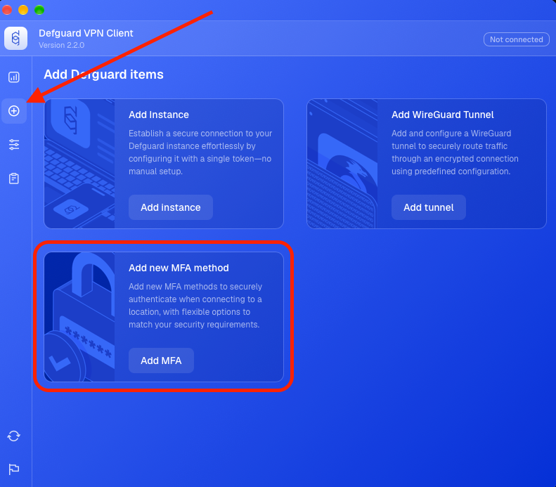</figure>

4. Select the instance you want to configure MFA for and click **Continue**.

<figure>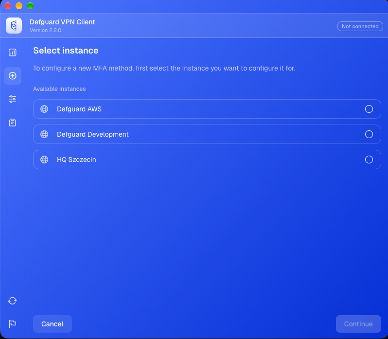</figure>

5. Continue with [Selecting MFA methods](configuring-mfa-methods.md#selecting-mfa-methods).

## Starting from location MFA settings

### Desktop client in tray view mode

1. Click the pen icon on the right side of the panel.

<figure>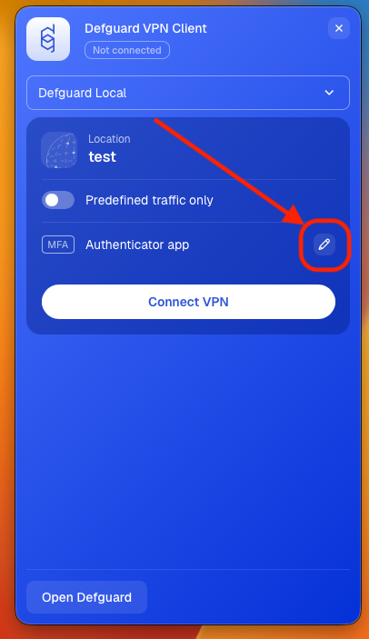</figure>

2. Select a method marked **Not configured** and click **Configure MFA**.

<figure>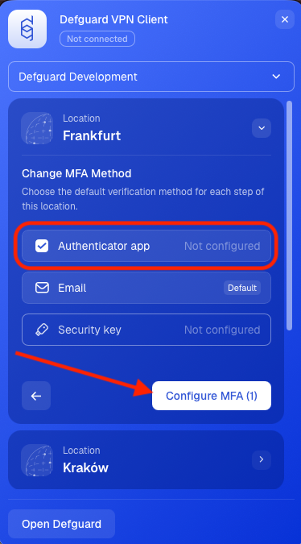</figure>

3. Continue with [Selecting MFA methods](configuring-mfa-methods.md#selecting-mfa-methods).

### Desktop client in full view mode

1. Click the pen icon on the right side of the panel.

<figure>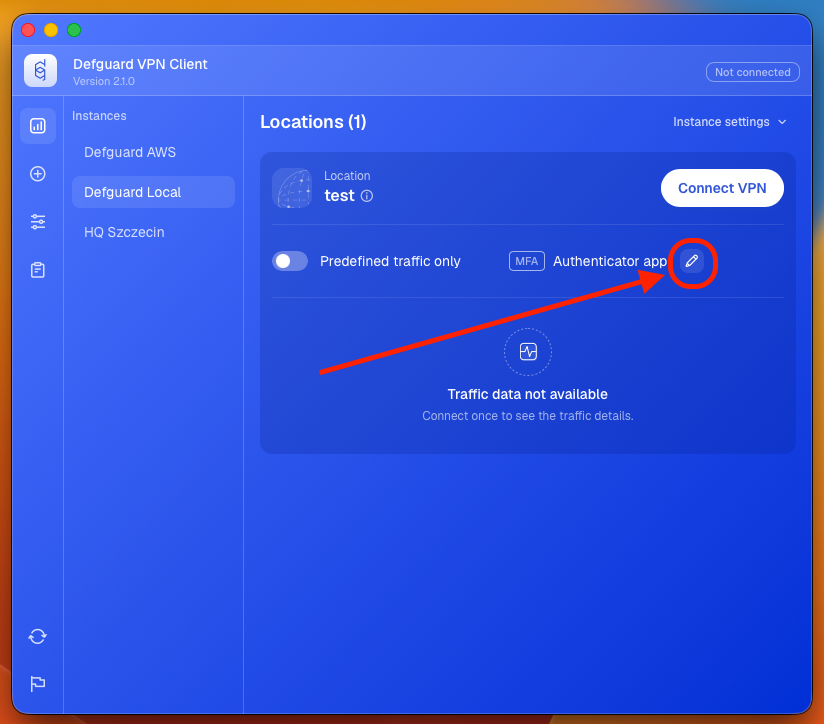</figure>

2. Select a method marked **Not configured** and click **Configure MFA**.

<figure>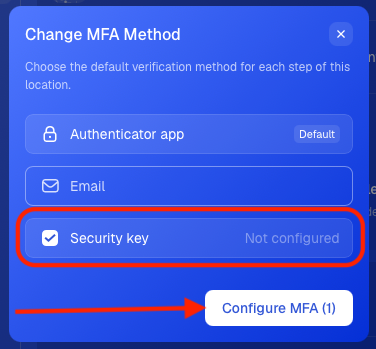</figure>

3. Continue with [Selecting MFA methods](configuring-mfa-methods.md#selecting-mfa-methods).

## Selecting MFA methods

1. Select the methods you want to set up and click **Continue**.

<figure>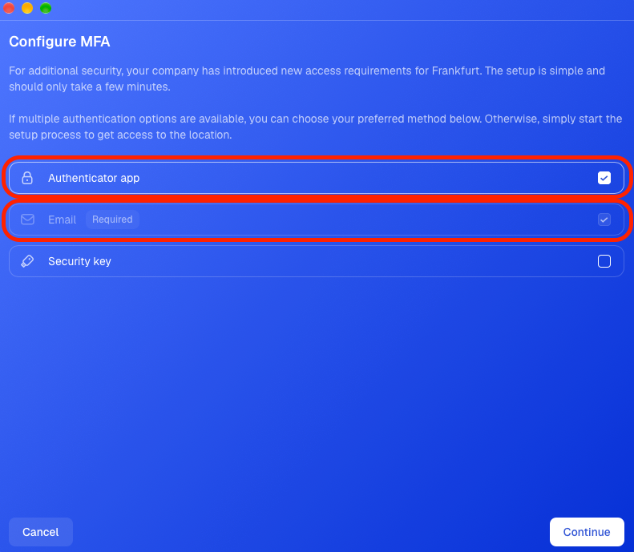</figure>

## Confirming your identity

Before adding a new method, Defguard asks you to confirm your identity with a method you have already set up. If you don't have any MFA method yet, Defguard sends a verification code to your email instead.

1. If you have more than one MFA method set up, choose the one you want to use and click **Continue**. If not, skip to step 2.

<figure>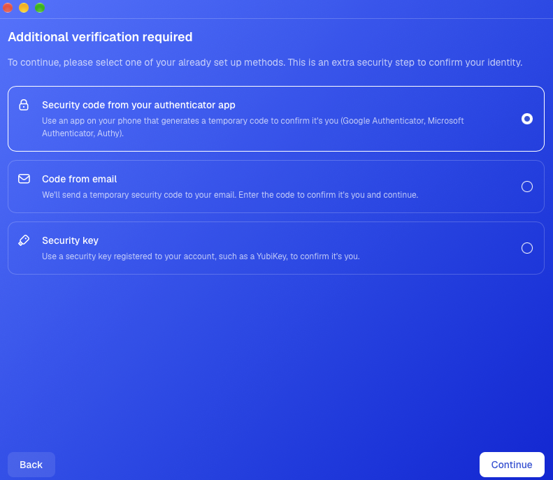</figure>

2. Confirm your identity as described below, depending on the method you use.

### Authenticator app

1. Enter the 6-digit code from your authenticator app and click **Continue**.

<figure>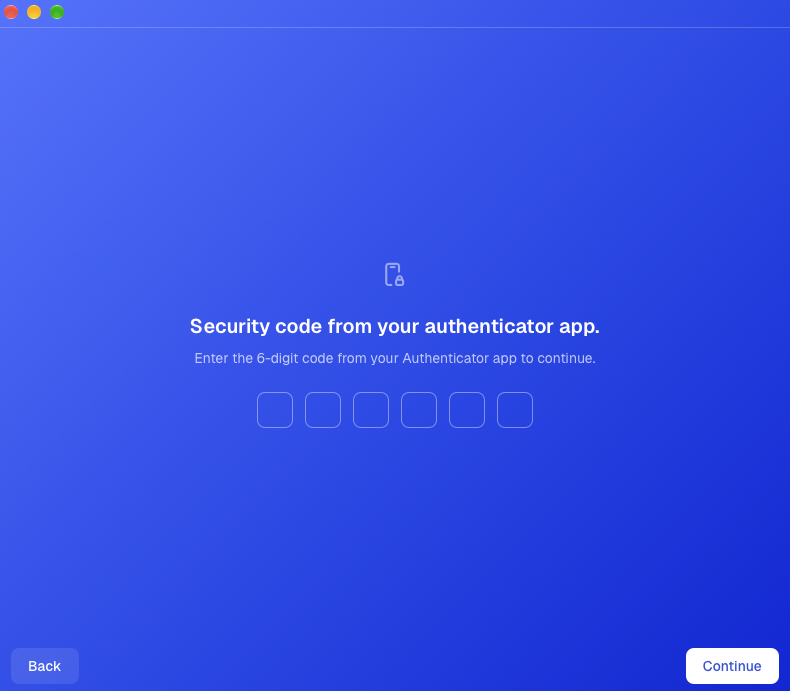</figure>

### Email

1. Enter the 6-digit code sent to your email and click **Continue**.


If you didn't receive the code, click **Resend email**.


<figure>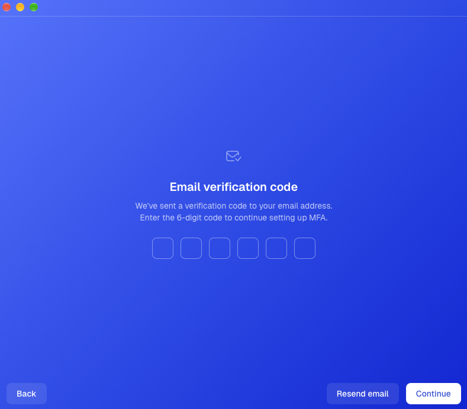</figure>

### Security key

1. Insert your security key.
2. On macOS and Linux, enter the key's PIN and click **Verify**. On Windows, click **Use security key** and enter the PIN in the Windows Security window.

<figure>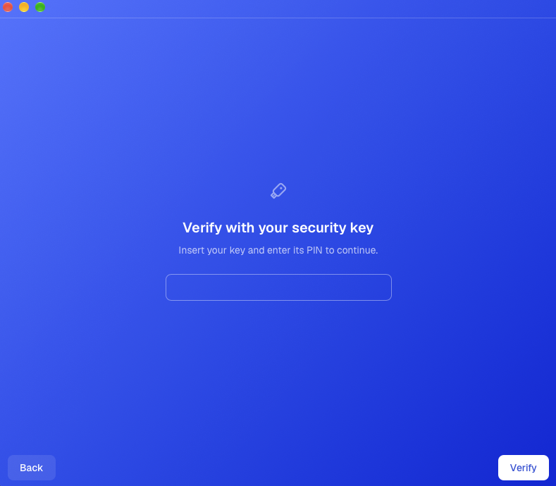</figure>

3. Touch your security key when it starts blinking.

<figure>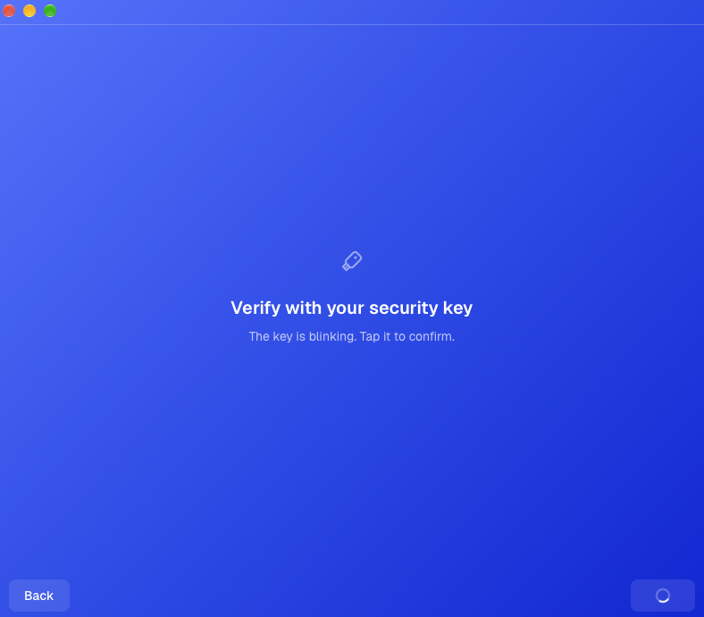</figure>

## Setting up MFA methods

### Authenticator app

1. Scan the QR code with your authenticator app (for example Google Authenticator).


If you can't scan the QR code, copy the code shown below it and enter it manually in your authenticator app.


2. Enter the 6-digit code from your authenticator app and click **Configure**.

<figure>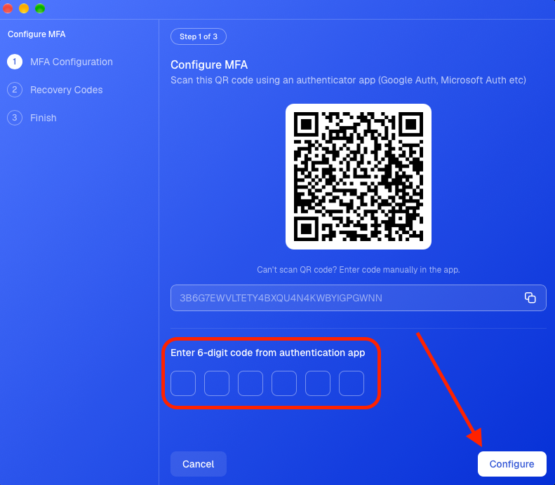</figure>

### Security key


The key must have a PIN. To set a PIN on a new key, and for the full walkthrough, see [Using a security key (FIDO2)](using-a-security-key-fido2.md).


1. Insert your security key.
2. Enter a name for the key so you can recognise it later.
3. On macOS and Linux, enter the key's PIN and click **Register**. On Windows, click **Register** and enter the PIN in the Windows Security window.

<figure></figure>

4. Touch your security key when it starts blinking.

<figure></figure>

## Finishing the configuration

1. If you see the **Download recovery codes** screen, click **Download codes** or **Copy to Clipboard**. If not, skip to step 3.


Recovery codes are your backup access if you lose your authenticator app. Store them securely, for example in a password manager.


<figure>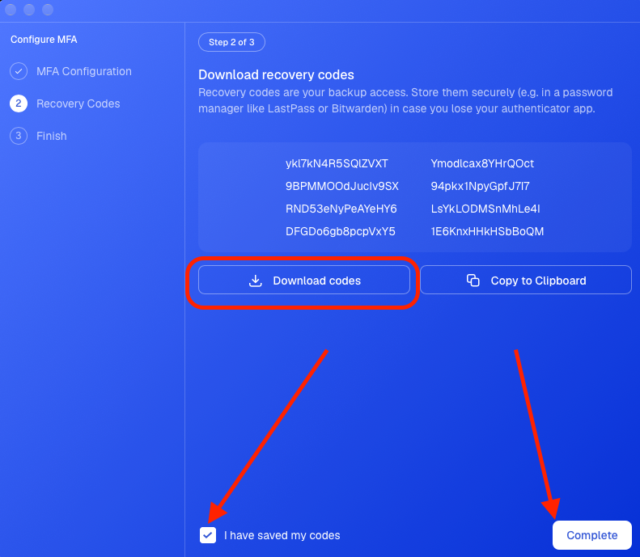</figure>

2. Select **I have saved my codes** and click **Complete**.
3. Click **Finish**.

<figure>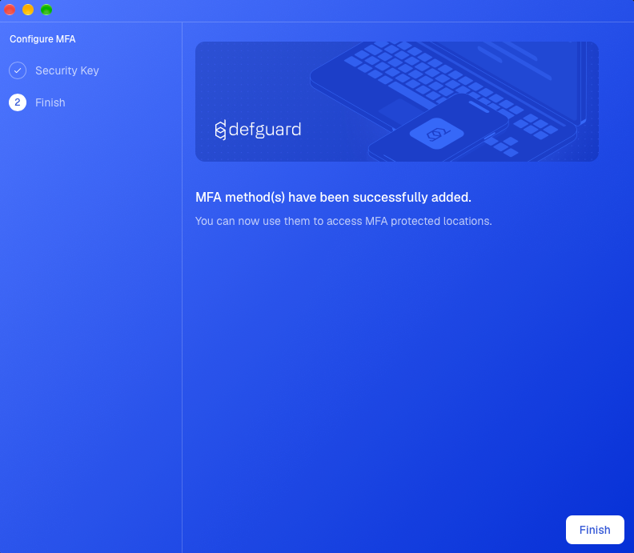</figure>

Your new MFA methods can be used immediately. To connect to a location with MFA, check out [this guide](using-multi-factor-authentication-mfa.md).
