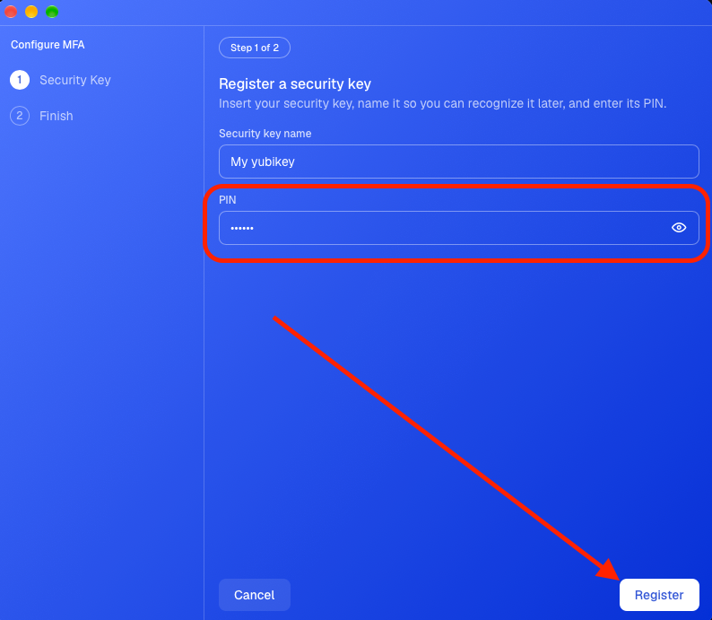
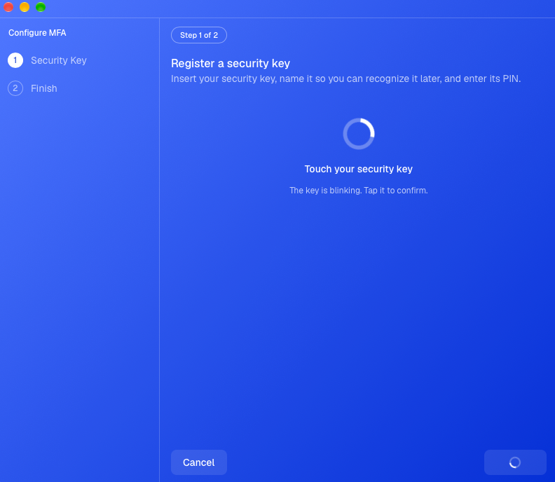
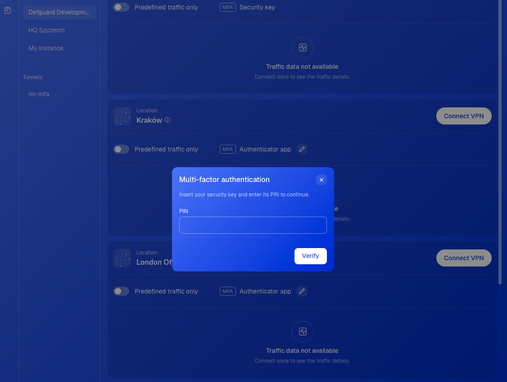
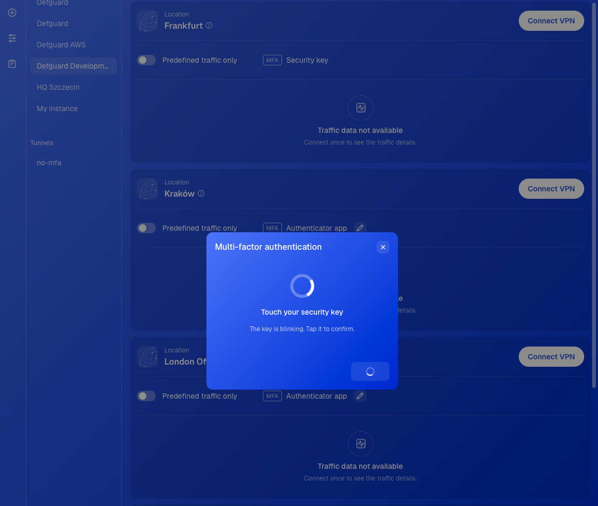

# Using a security key (FIDO2)

## Before you start

You need:

- Defguard desktop client 2.2.0 or newer on Windows, macOS, or Linux. The mobile client and the command-line client do not support security keys.
- A FIDO2 security key that Defguard trusts. Defguard accepts certified hardware keys, for example the YubiKey 5 series, including the FIPS and CCN models. YubiKey 4, YubiKey NEO, and keys that support only U2F do not work. See [WebAuthn security keys](../../support-1/troubleshooting-guides/webauthn-security-keys.md).
- A location that accepts **Security key** as an MFA method. Your administrator sets this up in the location's [MFA flow](../../features/wireguard/multi-factor-authentication-mfa-2fa/mfa-flows-and-methods.md).


Register the key in the desktop client. A passkey that you add in the **Passkeys** section of your profile in the Defguard web app signs you in to the web app, but the desktop client cannot use it to connect to a location.


## Set a PIN on the key

You enter the key's PIN every time you use the key. A new key has no PIN, so set one before you register the key. If your key already has a PIN, go to [Register the key](using-a-security-key-fido2.md#register-the-key).

### Windows

1. Open **Settings** and go to **Accounts** > **Sign-in options**.
2. Under **Security key**, click **Manage**. Insert the key and touch it when Windows asks.
3. Under **Security Key PIN**, click **Add**. Enter the new PIN twice and click **OK**.

### macOS and Linux

Use the tool from the key's manufacturer. For a YubiKey, use one of these:

- In [Yubico Authenticator](https://www.yubico.com/products/yubico-authenticator/), insert the key, open **Passkeys**, and choose **Set PIN**.
- In a terminal, run `ykman fido access change-pin` and enter the new PIN twice.


Remember the PIN. After 3 wrong PINs in a row, you must unplug the key and plug it in again before you can try again. After 8 wrong PINs in a row, the key locks. The only way to unlock it is a reset, which deletes every credential on the key, so you must then register the key again everywhere you use it.


## Register the key

1. Start the MFA setup in the desktop client. The quickest way is to click **Configure MFA** on the location. The client shows this button instead of **Connect VPN** when the location needs an MFA method that you have not set up. For the other ways to start, see [Configuring MFA methods](configuring-mfa-methods.md).
2. Select **Security key** and click **Continue**.

<figure><figcaption></figcaption></figure>

3. Confirm your identity with an MFA method that you already have. If you have none, enter the code that Defguard sends to your email. See [Confirming your identity](configuring-mfa-methods.md#confirming-your-identity).
4. Insert the key and enter a name for it, so you can recognise it later.
5. On macOS and Linux, enter the key's PIN and click **Register**. On Windows, click **Register**. In the Windows Security window, choose **Security key** if Windows asks which device to use, and enter the PIN.

<figure><figcaption></figcaption></figure>

6. Touch the key when it blinks.

<figure><figcaption></figcaption></figure>

7. If the client shows your recovery codes, save them and click **Complete**. Then click **Finish**. See [Finishing the configuration](configuring-mfa-methods.md#finishing-the-configuration).


On macOS and Linux, keep only one security key plugged in. The client cannot choose between two keys.


If you have a spare key, register it the same way. Then you can still connect if you lose one key.

## Connect with the key

If the location accepts more than one MFA method, the client uses the method that you chose for it. To make the security key the default, click the pen icon on the location, select **Security key**, and click **Save changes**. See [Using Multi-Factor Authentication (MFA)](using-multi-factor-authentication-mfa.md).

1. Click **Connect VPN** on the location.
2. Insert the key.
3. On macOS and Linux, enter the key's PIN and click **Verify**. On Windows, click **Use security key**. In the Windows Security window, choose **Security key** if Windows asks which device to use, and enter the PIN.

<figure><figcaption></figcaption></figure>

4. Touch the key when it blinks.

<figure><figcaption></figcaption></figure>

5. If the location's MFA flow has more steps, complete them. When the last step succeeds, the client connects.

In the tray view, the same fields and buttons show on the location card.

To use a different MFA method for one connection, click **Other methods**.

## Troubleshooting

| The client shows                                         | What to do                                                                                                                                                                                                                |
| -------------------------------------------------------- | ------------------------------------------------------------------------------------------------------------------------------------------------------------------------------------------------------------------------- |
| No security key detected                                 | Plug the key in and try again.                                                                                                                                                                                            |
| More than one security key is connected                  | Unplug every key except the one that you registered.                                                                                                                                                                      |
| Security key timed out waiting to be touched             | Try again, and touch the key while it blinks.                                                                                                                                                                             |
| This security key needs a PIN                            | Enter the key's PIN.                                                                                                                                                                                                      |
| A message that contains `CTAP2_ERR_PIN_NOT_SET`          | The key has no PIN. [Set a PIN](using-a-security-key-fido2.md#set-a-pin-on-the-key) and try again.                                                                                                                        |
| Security key rejected the PIN                            | Check the PIN and try again. If the message says that the key is locked, unplug the key, plug it in again, and try once more. If it still says that the key is locked, the key needs a reset. Contact your administrator. |
| This security key is not registered for your account     | Use the key that you registered, or [register this key](using-a-security-key-fido2.md#register-the-key).                                                                                                                  |
| This security key is already registered for your account | You do not have to register this key again. Use it to connect.                                                                                                                                                            |
| Only a hardware security key can be used                 | In the Windows Security window, choose **Security key**. Do not choose a phone or Windows Hello.                                                                                                                          |
| Security key is not a trusted hardware authenticator     | Defguard does not trust this model of key. Update the desktop client, or use a key from [Before you start](using-a-security-key-fido2.md#before-you-start).                                                               |

If you cannot connect at all, use another MFA method with **Other methods**, or ask your administrator for help.
