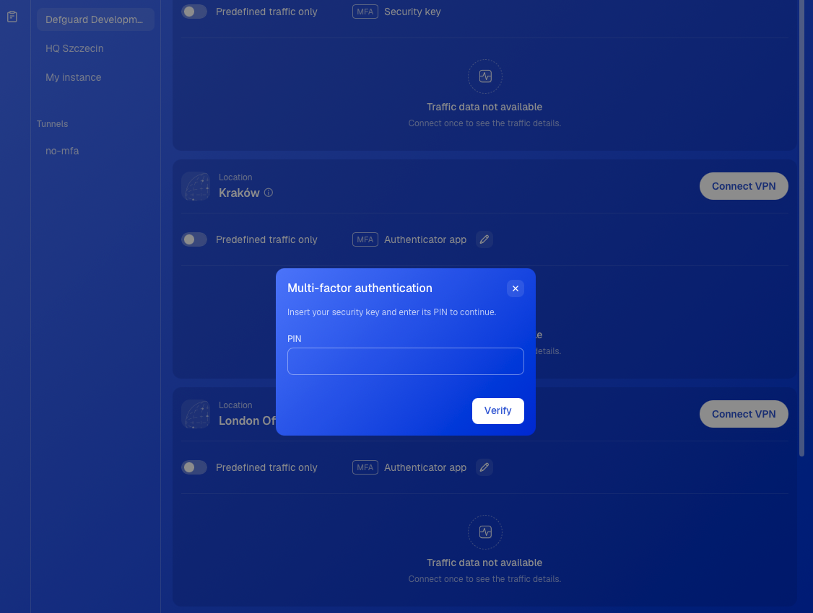
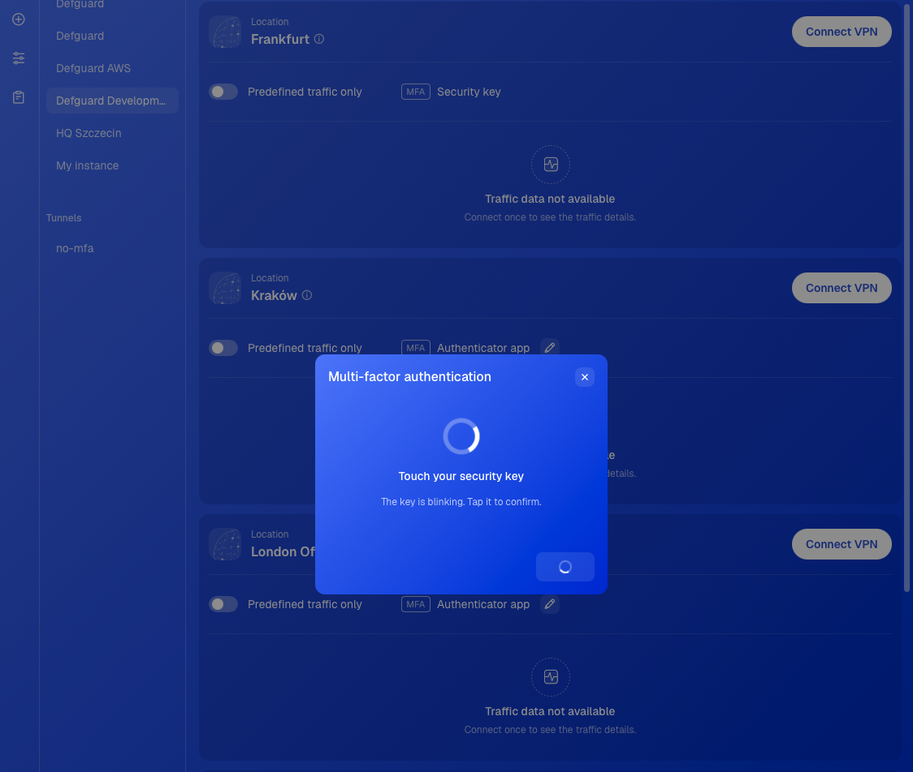

# Using a security key (FIDO2)


**Availability**

This feature requires an Enterprise plan. See the [pricing page](https://defguard.net/pricing/) for details.


### Before you start

You need:

* Defguard desktop client 2.2.0 or newer on Windows, macOS, or Linux. The command-line client does not support security keys. After you register a key in the desktop client, you can also use it in the mobile client over NFC. See Using a security key (FIDO2) in the mobile client.
* A hardware FIDO2 security key. See the table below.
* A location that accepts **Security key** as an MFA method. Your administrator sets this up in the location's MFA flow.

#### Supported security keys

Defguard accepts only physical keys that support FIDO2.

| Works                                                                         | Does not work                                                                 |
| ----------------------------------------------------------------------------- | ----------------------------------------------------------------------------- |
| YubiKey 5 series (USB-A, USB-C, Nano, NFC), including the FIPS and CCN models | YubiKey 4 and YubiKey NEO                                                     |
| Other FIDO2-certified hardware security keys                                  | Keys that support only U2F                                                    |
|                                                                               | Windows Hello, Touch ID, your phone, or a passkey saved in a password manager |

If you are not sure about your key, ask your administrator.


Register the key in the desktop client. A passkey that you add in the **Passkeys** section of your profile in the Defguard web app signs you in to the web app, but the desktop and mobile clients cannot use it to connect to a location.



Register the key in the desktop client as an MFA method. For the steps, see [#security-key-1](configuring-mfa-methods.md#security-key-1 "mention")


## Connect with the key


On macOS and Linux, keep only one security key plugged in.


If the location accepts more than one MFA method, the client uses the method that you chose for it. To make the security key the default, click the pen icon on the location, select **Security key**, and click **Save changes**. See [Using Multi-Factor Authentication (MFA)](using-multi-factor-authentication-mfa.md).

1. Click **Connect VPN** on the location.
2. Insert the key.
3. On macOS and Linux, enter the key's PIN and click **Verify**. On Windows, click **Use security key**. In the Windows Security window, choose **Security key** if Windows asks which device to use, and enter the PIN.

<figure><figcaption></figcaption></figure>

4. Touch the key when it blinks.

<figure><figcaption></figcaption></figure>

5. If the location's MFA flow has more steps, complete them. When the last step succeeds, the client connects.

In the tray view, the same fields and buttons show on the location card.

To use a different MFA method for one connection, click **Other methods**.

## Troubleshooting

| The client shows                                         | What to do                                                                                                                                                                                                                |
| -------------------------------------------------------- | ------------------------------------------------------------------------------------------------------------------------------------------------------------------------------------------------------------------------- |
| No security key detected                                 | Plug the key in and try again.                                                                                                                                                                                            |
| More than one security key is connected                  | Unplug every key except the one that you registered.                                                                                                                                                                      |
| Security key timed out waiting to be touched             | Try again, and touch the key while it blinks.                                                                                                                                                                             |
| This security key needs a PIN                            | Enter the key's PIN.                                                                                                                                                                                                      |
| A message that contains `CTAP2_ERR_PIN_NOT_SET`          | The key has no PIN. [Set a PIN](../../support-1/troubleshooting-guides/desktop-client/set-a-pin-for-fido2-security-key.md) and try again.                                                                                 |
| Security key rejected the PIN                            | Check the PIN and try again. If the message says that the key is locked, unplug the key, plug it in again, and try once more. If it still says that the key is locked, the key needs a reset. Contact your administrator. |
| This security key is not registered for your account     | Use the key that you registered, or [register this key](using-a-security-key-fido2.md#register-the-key).                                                                                                                  |
| This security key is already registered for your account | You do not have to register this key again. Use it to connect.                                                                                                                                                            |
| Only a hardware security key can be used                 | In the Windows Security window, choose **Security key**. Do not choose a phone or Windows Hello.                                                                                                                          |
| Security key is not a trusted hardware authenticator     | Defguard does not trust this model of key. Update the desktop client, or use a key from [Before you start](using-a-security-key-fido2.md#before-you-start).                                                               |

If you cannot connect at all, use another MFA method with **Other methods**, or ask your administrator for help.
