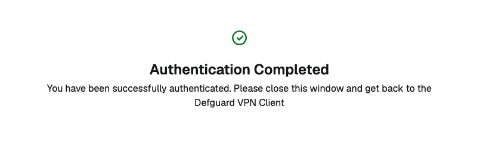

# Using Multi-Factor Authentication (MFA)

MFA is configured per location. Your administrator assigns each location an [MFA flow](../../features/wireguard/multi-factor-authentication-mfa-2fa/mfa-flows-and-methods.md): one or more verification steps in a fixed order. Each step allows one or more methods, and you pass the step with any one of them. The VPN connects only after you pass every step.

The location card shows what a location asks for next to the **MFA** badge: the method you will use for a single-step location, or for example **2-step verification** for a location with two steps.

## Supported methods

| Method                          | What you do                                                                                                                                                                                                   |
| ------------------------------- | ------------------------------------------------------------------------------------------------------------------------------------------------------------------------------------------------------------- |
| Authenticator app               | Enter the 6-digit code from your authenticator app. See [Connecting with a code](using-multi-factor-authentication-mfa.md#connecting-with-a-code).                                                            |
| Email                           | Enter the code sent to your email address. See [Connecting with a code](using-multi-factor-authentication-mfa.md#connecting-with-a-code).                                                                     |
| OpenID                          | Sign in with your identity provider in the browser. The client shows your provider's name instead of "OpenID". See [Connecting with OpenID](using-multi-factor-authentication-mfa.md#connecting-with-openid). |
| Security key                    | Touch your FIDO2 security key and enter its PIN. See [Using a security key (FIDO2)](using-a-security-key-fido2.md).                                                                                           |
| Mobile App Approval             | Scan a QR code with the Defguard mobile app and confirm with biometrics. See [below](using-multi-factor-authentication-mfa.md#multi-factor-authentication-via-mobile-biometry).                               |
| Mobile Biometric Authentication | Marked **Mobile client only**. The desktop client cannot use it; it is for connecting from the mobile app.                                                                                                    |

Authenticator app, Email and Security key have to be set up before you can use them. A method you have not set up is marked **Not configured**.

### When a method is missing

When a step of the location's MFA flow has no method you can use yet, the location shows **Configure MFA** in place of **Connect VPN**. Clicking it opens the MFA configuration wizard in the full view, even when you click it in the tray view. The wizard asks you to verify your identity, offers the methods this location needs, and walks you through setting them up; see [Configuring MFA methods](configuring-mfa-methods.md). After you click **Finish**, you are back on the location list and can connect with **Connect VPN**.

<figure><figcaption></figcaption></figure>

If a step allows only methods the desktop client cannot set up, for example only Mobile App Approval before you have [enabled biometry](../mobile-client/using-biometry-as-mfa-method.md#setting-up-biometry) on your phone, **Connect VPN** stays but is disabled. Its tooltip asks you to contact your administrator.

## Choosing your methods

The client picks one method for every step automatically. It uses the method you saved for that step, or else the first method in the step that you can use. In most cases you only click **Connect VPN** and follow the prompts.

To change the saved methods, click the pen icon next to the **MFA** badge on the location. The icon appears only while the location is disconnected, and only when at least one step offers you more than one method. Choose one method under each step (marked **Step 1**, **Step 2** and so on for a multi-step location) and click **Save changes**. The current choice is marked **Default**.

<figure><figcaption></figcaption></figure>

While you are connecting, **Other methods** on a verification screen lets you switch to another method for the current step:

* for a single-step location, select **Set as default MFA method** to keep the new choice for later connections;
* for a multi-step location, the change applies to this connection only. Use the pen icon to change your saved methods.

Your choices are saved separately for every location and only in this desktop client.

## Multi-step locations

A multi-step location asks for two or more verifications in order, for example an authenticator code first and then a security key. After you click **Connect VPN**, the client opens the verification screen for the first step. Each screen's title shows where you are, for example **Step 1/2: Authenticator app**. When you pass a step, the client moves to the next one, and the VPN connects after the last.

<figure><figcaption></figcaption></figure>

The whole verification has to be completed within 10 minutes of clicking **Connect VPN**. After 5 wrong codes or failed verifications in one step, you have to start again from **Connect VPN**.


Multi-step locations need Defguard client 2.2.0 or newer. An older client does not show such a location at all; update the client to reach it.


## Connecting with a code

1. Optional: to use a different method than the one shown next to the **MFA** badge, click the pen icon. If not, skip to step 3.

<figure><figcaption></figcaption></figure>

1. Choose the method under each step and click **Save changes**. See [Choosing your methods](using-multi-factor-authentication-mfa.md#choosing-your-methods).

<figure><figcaption></figcaption></figure>

3. Click the **Connect VPN** button on the location.

<figure><figcaption></figcaption></figure>

3. Enter the code from your authenticator app or email (depending on the method chosen for this step) and click **Verify**.

<figure><figcaption></figcaption></figure>

5. If this was the last step, your VPN connection is established immediately; otherwise the client moves on to the next step.

<figure><figcaption></figcaption></figure>

## Connecting with OpenID

1.  Click **Connect VPN** on the location. When OpenID is not the method of the first step, complete the steps before it first. 

    <figure><figcaption></figcaption></figure>
2.  Click **Authenticate with** followed by your provider's name. A browser window opens your identity provider's sign-in page (Google, Microsoft, Okta, etc.). To skip this screen and open the browser right away, turn on **Auto start OpenID MFA** in **Settings > General**. 

    <figure><figcaption></figcaption></figure>
3. After confirming your identity (logging in) you will see the "Authentication Completed" message.

<figure><figcaption></figcaption></figure>

4. Now you can close this window and go back to the Defguard Client. If this was the last step, your connection is established immediately; otherwise the client moves on to the next step.

<figure><figcaption></figcaption></figure>

## Connecting with a security key

When a step uses **Security key**, the client asks you to touch your FIDO2 security key and enter its PIN. To set a PIN on the key, register it and connect with it, see [Using a security key (FIDO2)](../mobile-client/using-security-key-fido2-as-mfa-method.md).

## Multi-Factor Authentication via Mobile Biometry

After configuring VPN on your mobile device and [enabling Biometry](../mobile-client/using-biometry-as-mfa-method.md#setting-up-biometry), we not only enable Biometry based connecting on a mobile device, but add an extra security layer to have the most secure/sophisticated MFA method available.

After enabling Biometry we create an additional private/public key pair, with the private key stored in hardware/secure storage, and indicate in the UI that this device can now be used for MFA using Biometry on a desktop client:

<figure><figcaption></figcaption></figure>

When a step of the location's MFA flow allows it, you can choose **Mobile App Approval** for that step in the desktop client.


To approve connections from Defguard desktop client 2.2.0 or newer, you need Defguard mobile app 2.2.0 or newer. This applies to every location with MFA, not only multi-step ones. An older mobile app can scan the QR code, but the approval is rejected and the desktop client shows "Your Defguard mobile app is out of date. Upgrade to approve this connection."


<figure><figcaption></figcaption></figure>

When the client reaches that step, it shows a QR code.

<figure><figcaption></figcaption></figure>

This QR code must be scanned on the mobile device for additional MFA steps:

1. Biometry authentication, that enables access to device secure storage
2. Additional validation with private/public key pair between mobile/desktop/core server. After that, our “normal” MFA flow (with session keys, WireGuard private/public keys) takes place.

Here you can see the whole flow done with multiple steps including the user, desktop (and mobile) the Edge and Defguard Core and gateway in the final step:

<figure><figcaption></figcaption></figure>
