# Using Multi-Factor Authentication (MFA)

Some locations ask you to confirm your identity before the VPN connects. Your administrator sets this up for each location as an MFA flow: one or more steps that you complete in a fixed order. In each step you use one method, and if the step accepts several methods, you choose which one. The client connects after the last step.

## Supported methods

| Method                                                                                        | What you do                                                               |
| --------------------------------------------------------------------------------------------- | ------------------------------------------------------------------------- |
| [Authenticator app](using-multi-factor-authentication-mfa.md#authenticator-app-or-email-code) | Enter the 6-digit code from your authenticator app.                       |
| [Email](using-multi-factor-authentication-mfa.md#authenticator-app-or-email-code)             | Enter the 6-digit code sent to your email address.                        |
| [OpenID](using-multi-factor-authentication-mfa.md#openid)                                 | Sign in with your identity provider (Google, Entra, etc.) in the browser. |
| [Security key](using-multi-factor-authentication-mfa.md#security-key-fido2)                   | Enter the key's PIN and touch the key.                                    |
| [Mobile App Approval](using-multi-factor-authentication-mfa.md#mobile-app-approval)           | Scan a QR code with the Defguard mobile app and confirm with biometrics.  |

You can set up the authenticator app, email and security key in the desktop client. See [Configuring MFA methods](configuring-mfa-methods.md).


Locations whose MFA flow has more than one step require Defguard desktop client 2.2.0 or newer. Older clients do not show these locations.


## Connecting to a location with MFA

### Desktop client in full view mode

1. Click **Connect VPN** on the location.

<figure>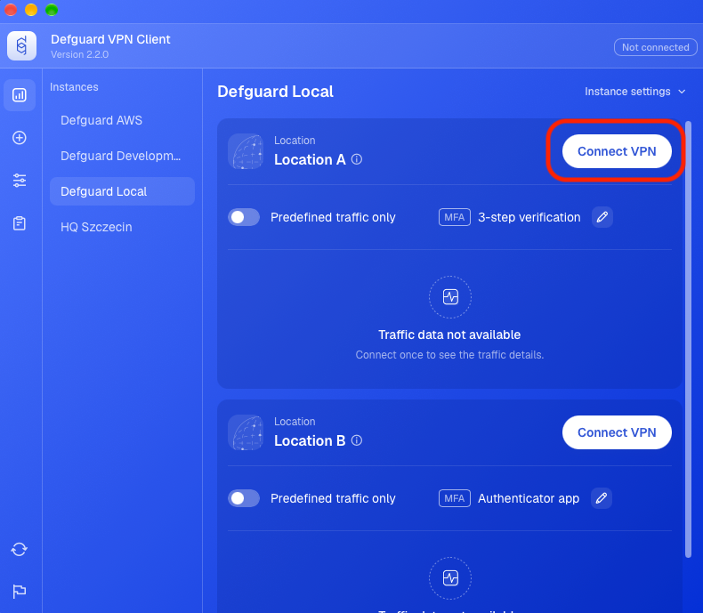</figure>

2. Complete the first step. For what to do in each method, see [Completing a step](using-multi-factor-authentication-mfa.md#completing-a-step).

<figure>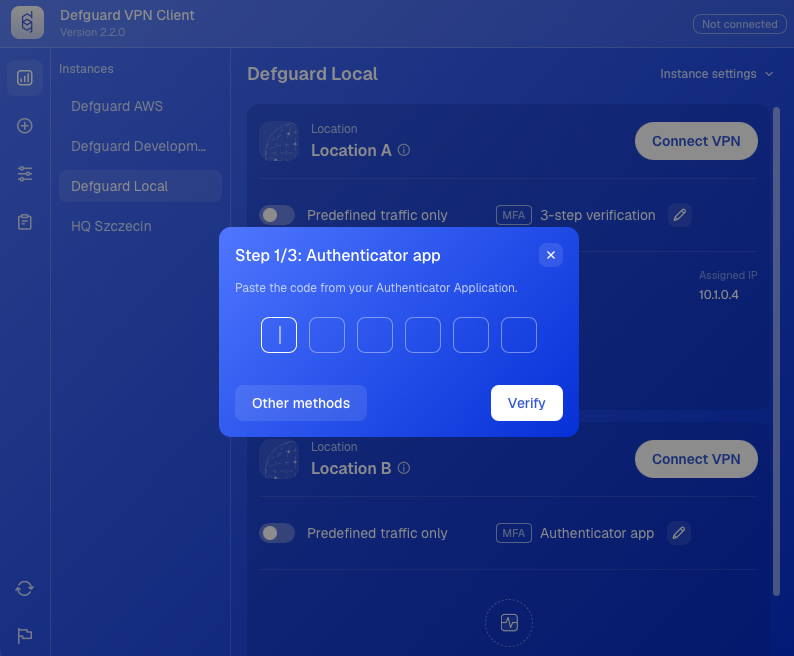</figure>

3. Complete the remaining steps the same way. After the last step, the client connects.

<figure>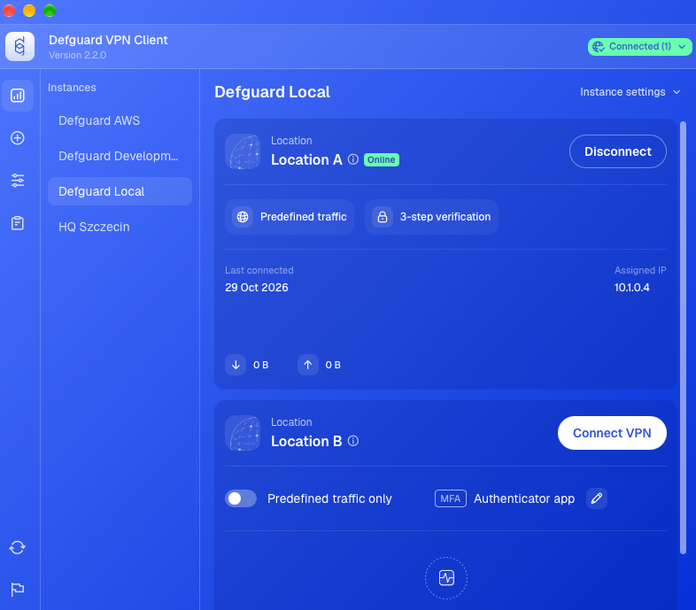</figure>

### Desktop client in tray view mode

1. Click **Connect VPN** on the location.

<figure>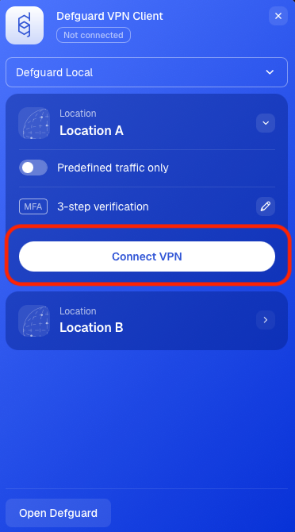</figure>

2. Complete the first step on the location card.

<figure>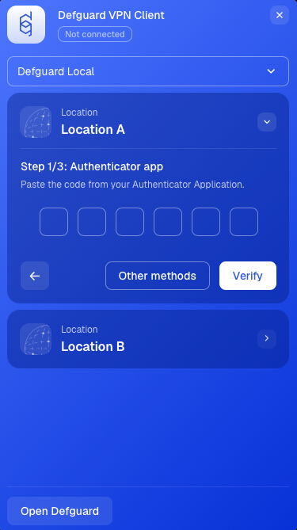</figure>

3. Complete the remaining steps the same way. After the last step, the client connects.

<figure>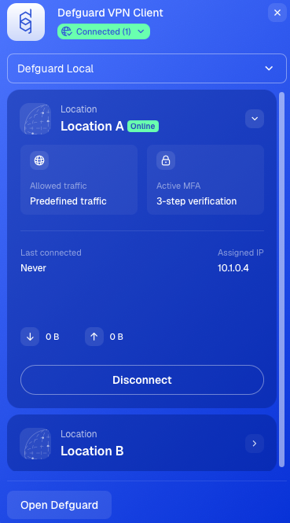</figure>

## Completing a step

### Authenticator app or email code

Set up the method first, in the desktop client, as described in [Configuring MFA methods](configuring-mfa-methods.md), or in your Defguard profile, as described in [Setting up 2FA/MFA](../setting-up-2fa-mfa.md).

Enter the code from your authenticator app or email and click **Verify**.

<figure></figure>

If your code is rejected, see [TOTP / email codes for MFA do not work](../../support-1/troubleshooting-guides/totp-email-codes-for-mfa-do-not-work.md).

### OpenID

1. Click **Authenticate with** and your provider's name, for example **Authenticate with Google**.

<figure>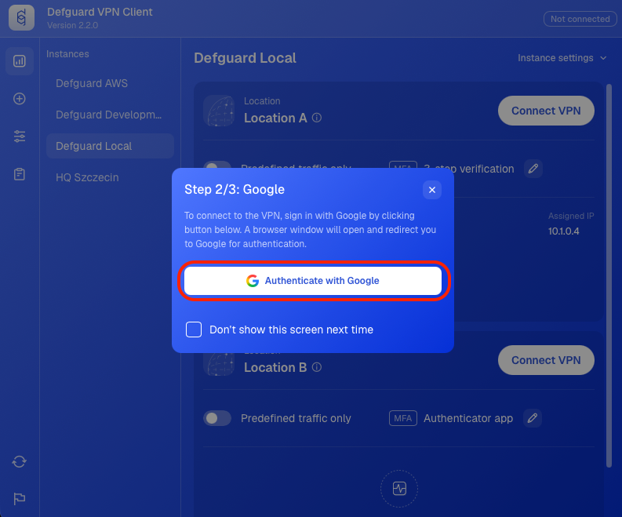</figure>

2. Sign in with your provider. When you see **Authentication Completed**, close the browser window and go back to the client.

<figure>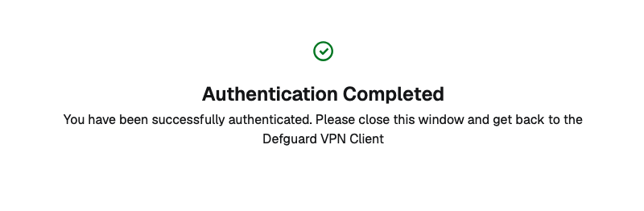</figure>

### Security key (FIDO2)

To connect with a hardware security key, such as a YubiKey, see [Using a security key (FIDO2)](using-a-security-key-fido2.md#connect-with-the-key).

### Mobile App Approval

With **Mobile App Approval**, you approve a desktop client connection from the Defguard mobile app.

You need:

- The Defguard mobile app with the same instance added. See [Adding new Instance](../mobile-client/instance-adding.md).
- Biometrics enabled for that instance in the mobile app. You can enable it only while adding the instance. See [Using Biometry as MFA method](../mobile-client/using-biometry-as-mfa-method.md#setting-up-biometry).

A device that can approve connections shows a fingerprint icon next to its name in the device list of your Defguard profile:

<figure></figure>

1. On your phone, open the Defguard mobile app, open the instance and tap the QR code button in the bottom right corner.

<figure>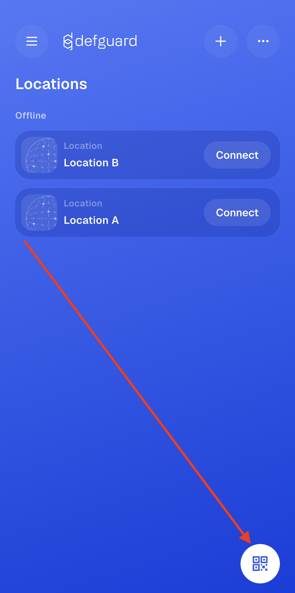</figure>

2. Scan the QR code on your computer screen and confirm with biometrics.

<figure>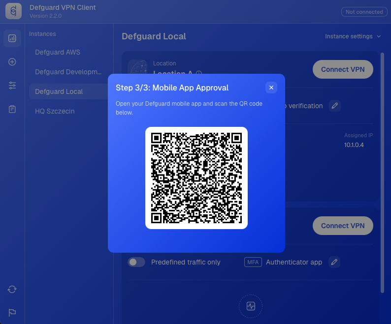</figure>

#### How it works

After you [enable Biometry](../mobile-client/using-biometry-as-mfa-method.md#setting-up-biometry) on your mobile device, we not only enable Biometry-based connecting on a mobile device, but add an extra security layer to have the most secure/sophisticated MFA method available. We create an additional private/public key pair, with the private key stored in hardware/secure storage.

The QR code shown by the desktop client must be scanned on the mobile device for additional MFA steps:

1. Biometry authentication that enables access to device secure storage
2. Additional validation with private/public key pair between mobile/desktop/core server. After that, our “normal” MFA flow (with session keys, WireGuard private/public keys) takes place.

Here you can see the whole flow done with multiple steps including the user, desktop (and mobile), the Edge and Defguard Core and gateway in the final step:

<figure></figure>

## Choosing MFA methods

If a step accepts more than one method, the client uses your default method for that step. Defaults are saved for each location, on this computer only.

### Setting default methods

#### Desktop client in full view mode

1. Click the pen icon next to the MFA method on the location. The icon is hidden while the location is connected.

<figure></figure>

2. Under each step, select the method that you want to use by default and click **Save changes**.

<figure>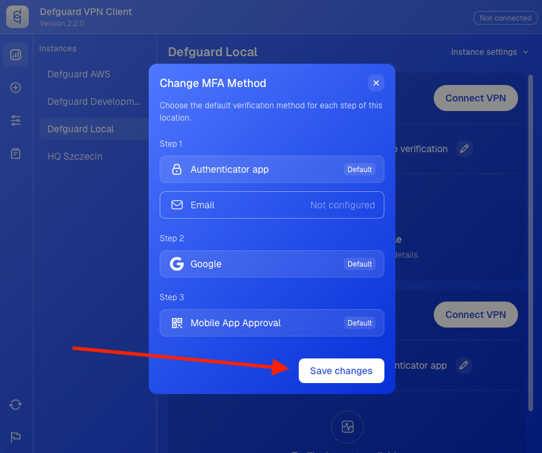</figure>

#### Desktop client in tray view mode

1. Click the pen icon on the right side of the panel. The icon is hidden while the location is connected.

<figure></figure>

2. Under each step, select the method that you want to use by default and click **Save changes**.

<figure>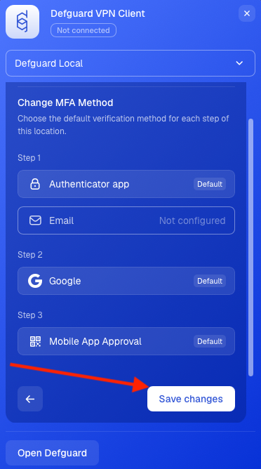</figure>


To set up the authenticator app, email or security key from here, select the method marked **Not configured** and click **Configure MFA**. See [Configuring MFA methods](configuring-mfa-methods.md#starting-from-location-mfa-settings).


### Using another method for one connection

If you cannot use the default method of a step, for example because you do not have your phone with you, choose another method while you connect.

#### Desktop client in full view mode

1. On the step, click **Other methods**. The button is shown only when the step accepts more than one method that you have set up.

<figure>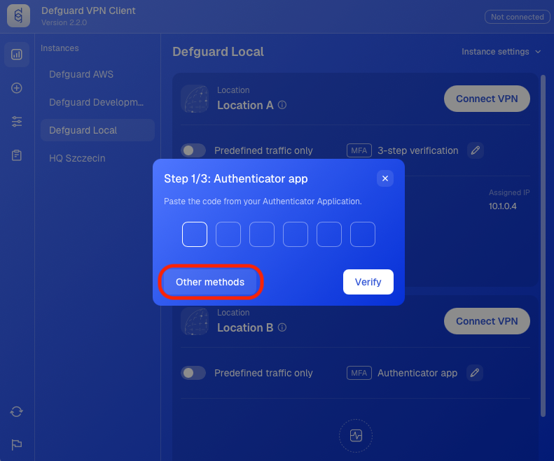</figure>

2. Select the method and click **Continue**.

<figure>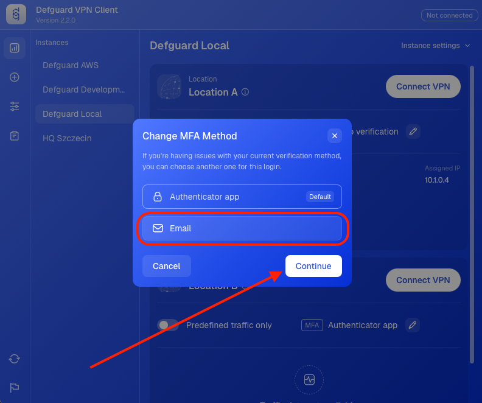</figure>

#### Desktop client in tray view mode

1. On the location card, click **Other methods**. The button is shown only when the step accepts more than one method that you have set up.

<figure>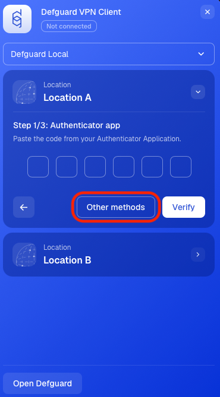</figure>

2. Select the method and click **Continue**.

<figure>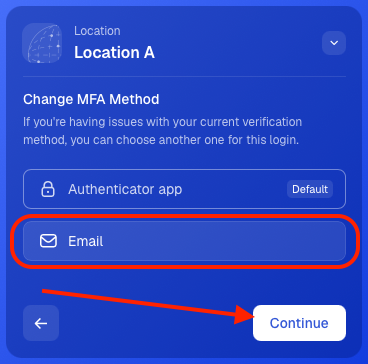</figure>
