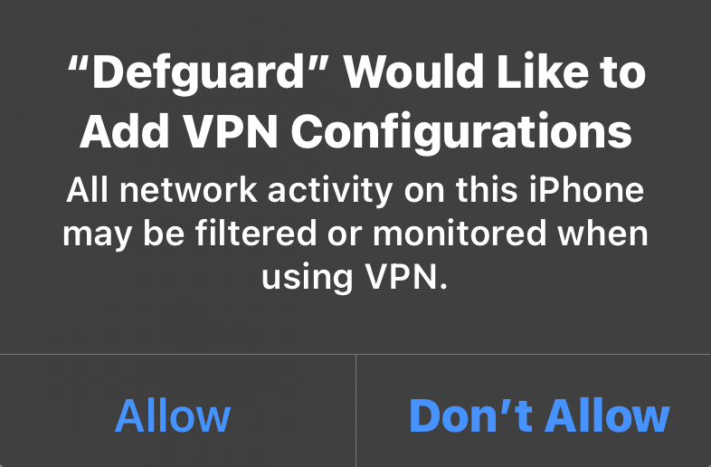

# Connecting to Instance

In this guide, you will learn how to connect to location. If you haven't added an instance yet, follow [this guide](instance-adding.md).

## Connecting to location without MFA

1. Open Defguard
2. Click on Instance you want to connect to.
3. Click **"Connect"** next to location you want to use.

<figure><figcaption></figcaption></figure>

4. Choose your routing method

<figure><figcaption></figcaption></figure>

4. Confirm


Your phone will need to add new VPN configuration, you will see popup like this:

Please click **Allow**, without this permission, Defguard cannot establish VPN connection.



If your location does not use MFA, your VPN connection should be established immediately after confirming your routing method.


### Connecting to MFA location

Some locations ask you to confirm your identity before the VPN connects. This is called multi-factor authentication (MFA). Your administrator decides which locations require it and which methods you can use.

#### Supported methods

| Method             | What you do                                                                                                                                             |
| ------------------ | ------------------------------------------------------------------------------------------------------------------------------------------------------- |
| Biometric          | Confirm with Face ID, Touch ID or your fingerprint.                                                                                                     |
| Authenticator App  | Enter the 6-digit code from your authenticator app.                                                                                                     |
| Email              | Enter the code sent to your email address.                                                                                                              |
| OpenID             | Sign in with your identity provider in the browser. The app shows your provider's name instead of "OpenID".                                             |
| FIDO2 Security key | Enter the key's PIN and hold the key to your phone over NFC. See [Using security key (FIDO2) as MFA method](using-security-key-fido2-as-mfa-method.md). |


Biometric verification has to be enabled on the device first. You can turn it on when you add an instance, or later from the prompt the app shows when a location needs it.


#### Connecting to a location with MFA

1. Open your instance and tap the location you want to connect to.
2. The **Connect** sheet opens and shows the MFA section.
3. Check the method (or methods) and tap **Connect VPN**.
4. Complete each verification screen. The tunnel starts once all of them pass.

<figure><figcaption></figcaption></figure>

#### What is the default path?

The **default path** is the method the app uses for each verification step of a location. It is picked for you automatically, so in most cases you only tap **Connect VPN** and follow the prompts.

When you connect for the first time, the app takes the first method in each step that you can use on this phone. After that, it remembers your choice.

The default path is saved separately for every location and only on this device. Changing it on your phone does not change it in the desktop client or on another phone.

If a saved method stops being usable, for example because your administrator removed it or you turned off biometrics, the app switches to the next available method in that step. You do not need to fix anything by hand.

#### Chainging the default path

After Clicking "Connect" on the location, click "Change default MFA methods".

<figure><figcaption></figcaption></figure>

<figure><figcaption></figcaption></figure>

#### Single-step locations

A single-step location asks for one verification. The Connect sheet lists every method allowed for that location, and the current default is marked with a **Default** badge.

* To use a different method, select it in the list before tapping **Connect VPN**.
* The method you successfully connect with becomes the new default for this location.
* A cancelled or failed attempt does not change the default.

<figure><figcaption></figcaption></figure>

#### Multi-step locations

A multi-step location asks for two or more verifications in a fixed order, for example an authenticator code first and then biometrics. Each step can allow several methods, and you need to pass one method from every step.

The Connect sheet shows your default path as one method per step, labeled **Step 1**, **Step 2** and so on. During the connection, each verification screen shows which step you are on.

Unlike single-step locations, choosing a method while connecting does not change your defaults. To change the default path:

1. Open the Connect sheet for the location.
2. Tap **Change default MFA methods**.
3. Select one method under each step.
4. Tap **Save changes**.


**Change default MFA methods** only appears when at least one step offers more than one method you can use. If every step has a single option, there is nothing to choose.


### Methods that cannot be selected

Some methods in the list may be greyed out with a short note:

| Note           | Meaning                                                            |
| -------------- | ------------------------------------------------------------------ |
| Not configured | You have not set up this method in your Defguard account yet.      |
| Not set up     | Biometric verification is not enabled on this device.              |
| Desktop only   | The mobile app cannot perform this method. Use the desktop client. |

If a step has no method you can use, tapping **Connect VPN** opens a dialog that explains why and what to do next:

* **Biometrics Required**: the location needs biometric verification, but it was not enabled when you added the instance. Add the instance again and enable biometrics during setup.
* **Security Key Required**: register a security key from the Defguard desktop client, then try again.
* **Location Not Supported**: the location needs a method that is not configured in your account or is only available in the desktop client.
